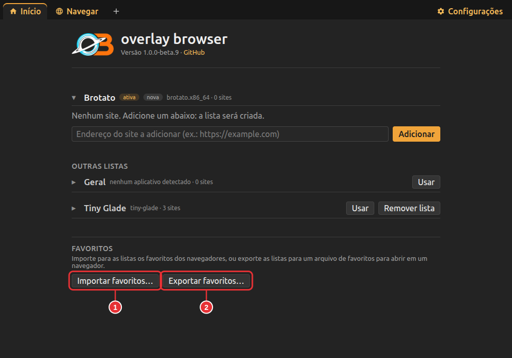
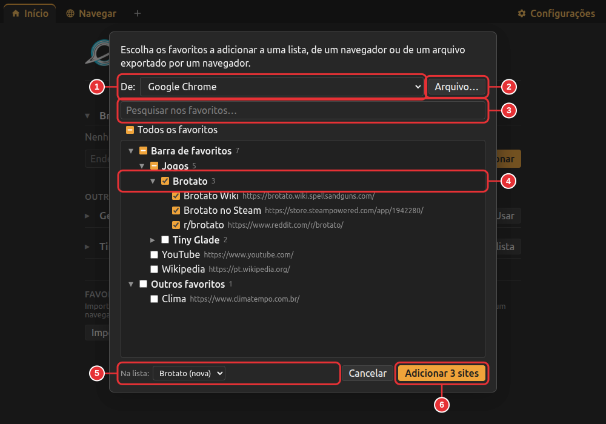
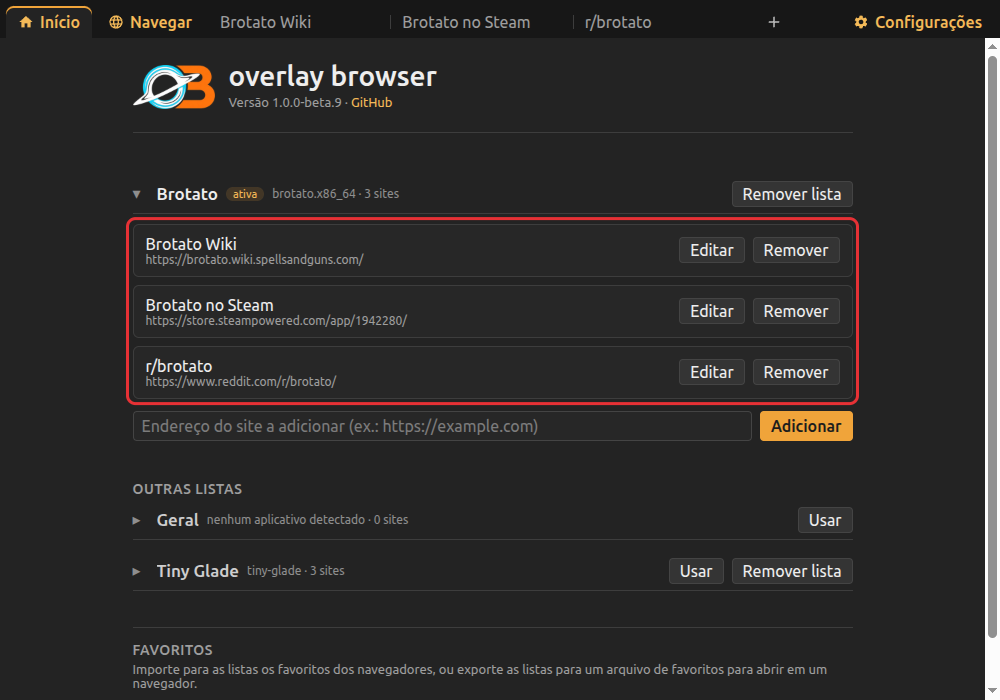
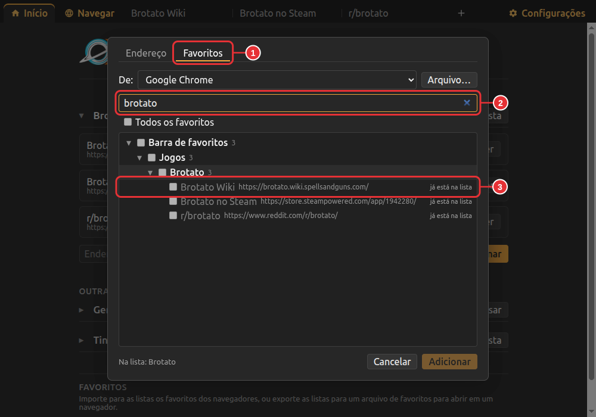
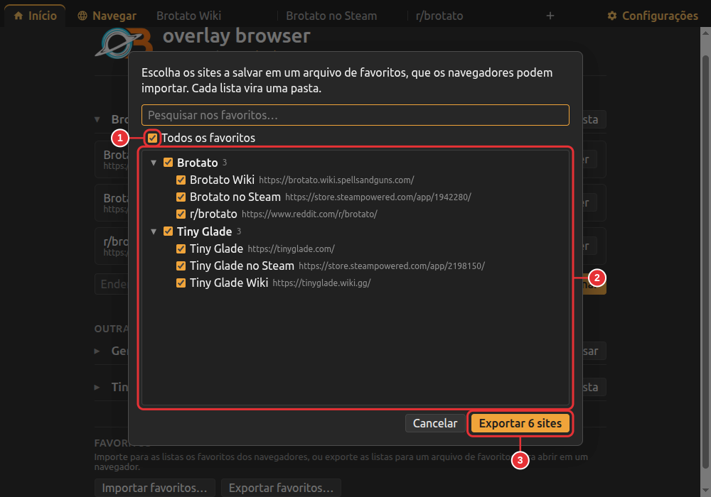

# Importar e exportar favoritos

Você já tem os sites dos seus jogos nos favoritos do navegador? Importe-os para as listas do Overlay Browser sem digitar os endereços de novo. Você também pode exportar as listas para um arquivo de favoritos que pode ser importado em qualquer navegador.

Aqui o overlay está aberto sobre **Brotato**, cuja lista ainda está vazia. A lista de **Tiny Glade** já tem três sites. Veja [Uma lista por jogo](lists-per-game.md).

Nas capturas de tela, os elementos citados no texto são destacados por um quadro vermelho; números como ❶ no texto indicam o elemento com o mesmo número na captura.

## 1. A seção Favoritos em Início

No fim de **Início** fica a seção *Favoritos*, com **Importar favoritos…** ❶ e **Exportar favoritos…** ❷.

## 2. Escolha os favoritos para importar

Clique em **Importar favoritos…**. Na janela, você encontra estas opções.

- **De** ❶ seleciona o perfil do navegador de onde vêm os favoritos. O overlay detecta Chrome, Edge, Brave, Opera, Vivaldi, Chromium, Firefox, LibreWolf e navegadores semelhantes. O Firefox pode ficar aberto. Na próxima vez, o overlay oferece o último perfil escolhido.
- **Arquivo…** ❷ importa um arquivo HTML exportado pelo gerenciador de favoritos de um navegador. No macOS, esse é o único método. Primeiro exporte os favoritos pelo navegador.
- **Pesquisar nos favoritos…** ❸ encontra favoritos e pastas por nome ou endereço.
- Use as **caixas de seleção** ❹ para marcar favoritos ou pastas inteiras. *Todos os favoritos* seleciona tudo. Aqui marcamos a pasta *Brotato*.
- **Na lista** ❺ escolhe a lista de destino. A lista ativa vem selecionada. Se ainda estiver *nova*, como a de Brotato, a lista é criada com os sites importados.
- O botão **Adicionar 3 sites** ❻ mostra quantos sites serão adicionados.

Os favoritos viram sites da lista e mantêm seus nomes.

## 3. Importe pelo botão “+”

Você também pode importar pelo **+** na barra superior. Abra a aba **Favoritos** ❶, ao lado de *Endereço*. Os sites sempre entram na lista ativa. Use **Pesquisar nos favoritos…** ❷ para encontrá-los. Um endereço que **já está na lista** ❸ aparece em cinza e não pode ser selecionado. Assim, a importação não cria duplicatas.

## 4. Exporte as listas

**Exportar favoritos…**, na seção *Favoritos* de Início, salva os sites em um arquivo HTML que qualquer navegador pode importar. Cada lista vira uma pasta. No início, **Todos os favoritos** ❶ estão selecionados. Na **lista** ❷, desmarque os sites ou listas que não quer exportar. **Exportar 6 sites** ❸ pergunta onde salvar o arquivo.

