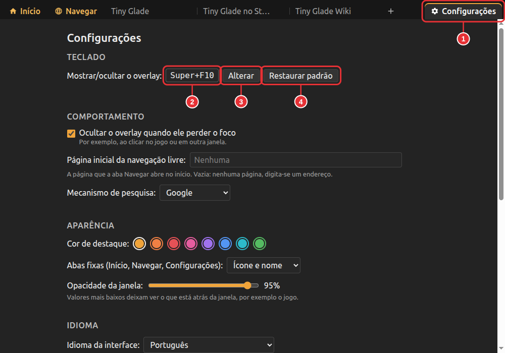
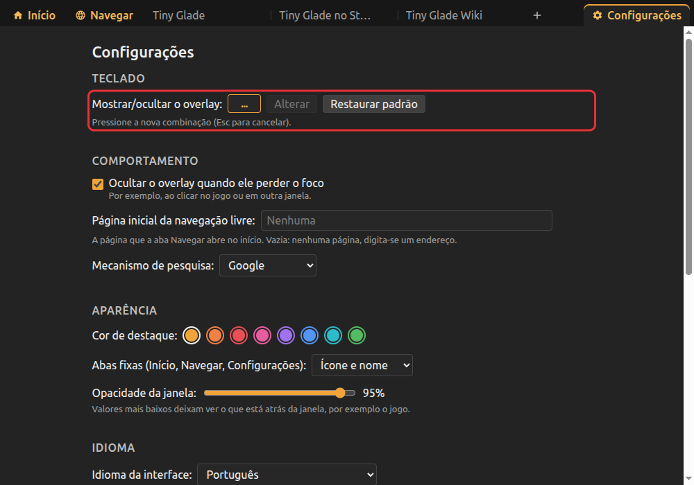
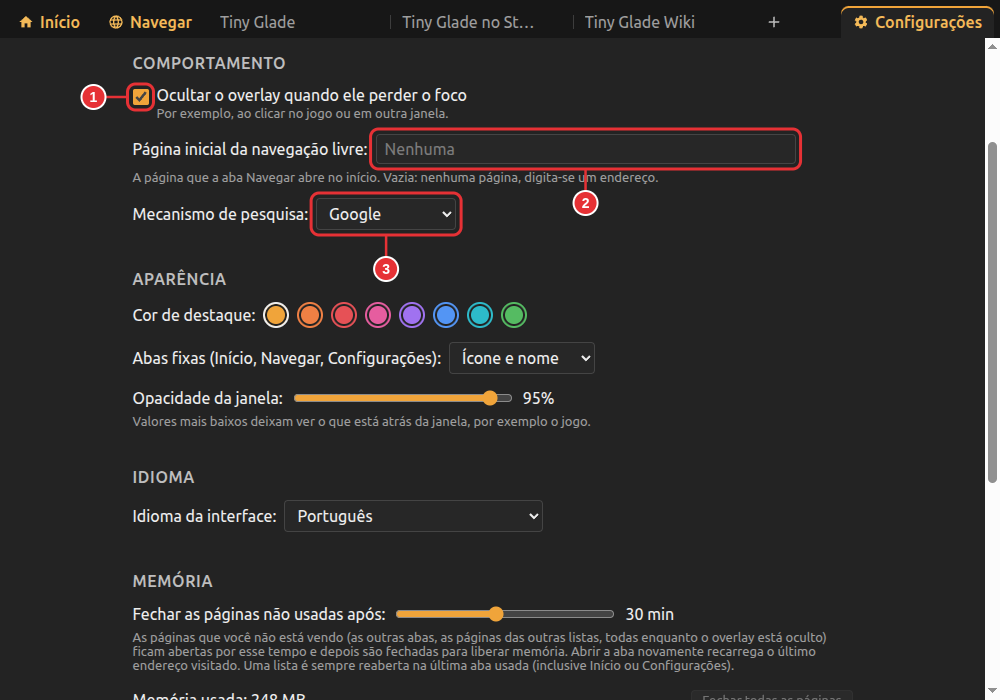
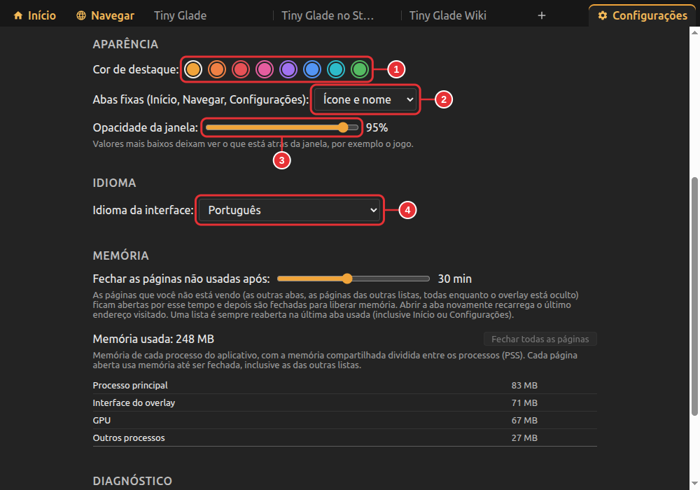
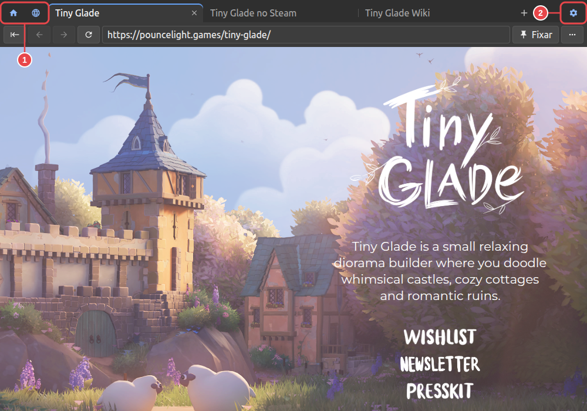

# Personalize o overlay

Em **Configurações**, você escolhe a combinação de teclas, o comportamento, a aparência e o idioma. As mudanças valem imediatamente e ficam salvas.

Nas capturas de tela, os elementos citados no texto são destacados por um quadro vermelho; números como ❶ no texto indicam o elemento com o mesmo número na captura.

## 1. A combinação de teclas

Abra **Configurações** ❶ no canto superior direito ou pelo menu do ícone na área de notificação. Na seção *Teclado* aparece a **combinação atual** ❷ que exibe e oculta o overlay. **Alterar** ❸ registra uma nova. **Restaurar padrão** ❹ recupera a combinação padrão (Win+F10, Super+F10 no Linux, Cmd+Shift+Espaço no macOS).

Depois de clicar em **Alterar**, pressione a combinação que preferir, por exemplo `Ctrl+Shift+O`. Esc cancela.

Você pode usar F1 a F24 sozinhas ou combinar outra tecla com Ctrl, Alt, Shift ou Win (Super no Linux, Cmd no macOS). Se outro programa já usar a combinação, aparece uma mensagem e a combinação anterior continua ativa.

> **Durante o jogo.** O jogo também recebe a combinação. Escolha uma que não esteja ligada a um comando do jogo para evitar executá-lo ao abrir o overlay.

## 2. Comportamento

Na seção *Comportamento*, você encontra estas opções.

- **Ocultar o overlay quando ele perder o foco** ❶ vem ativada. O overlay se oculta ao clicar no jogo ou em outra janela. Desative a opção se quiser que ele fique visível enquanto joga. A combinação de teclas continua ocultando o overlay. A opção também aparece no menu do ícone na área de notificação.
- **Página inicial da navegação livre** ❷ define a página que a aba Navegar abre primeiro. Deixe o campo vazio para abrir a aba sem página. Veja [Navegação livre](free-browsing.md).
- **Mecanismo de pesquisa** ❸ define onde pesquisar o texto digitado em Navegar. Escolha Google, Bing, DuckDuckGo, Brave Search, Ecosia, Startpage ou *Personalizado*. No endereço personalizado, use `%s` no lugar do texto da pesquisa.

A opção *Procurar novas versões* avisa em Início quando sai uma nova versão. A edição da Microsoft Store recebe as atualizações pela loja.

## 3. Aparência e idioma

Na seção *Aparência*, você encontra estas opções.

- **Cor de destaque** ❶ muda a cor das abas fixas, dos botões principais e de outros detalhes.
- **Abas fixas** ❷ mostra Início, Navegar e Configurações com ícone e nome. *Somente ícone* deixa mais espaço para as abas dos sites.
- **Opacidade da janela** ❸ vai de 30% a 100%. Com valores menores, você consegue ver o jogo atrás da janela.

Na seção *Idioma*, o **Idioma da interface** ❹ usa por padrão o *Idioma do sistema* quando disponível (italiano, inglês, francês, português, russo, espanhol e alemão). Se o idioma não estiver disponível, o aplicativo usa inglês.

Aqui o overlay usa azul como cor de destaque e mostra **somente os ícones das abas fixas** ❶ ❷. A captura inclui apenas a janela, então não mostra o jogo por trás nem o efeito da opacidade.

## Outras seções

Mais abaixo, *Memória* mostra quanta memória o aplicativo usa e quando as páginas sem uso são fechadas. *Diagnóstico* ajuda a coletar informações para relatar um problema.
