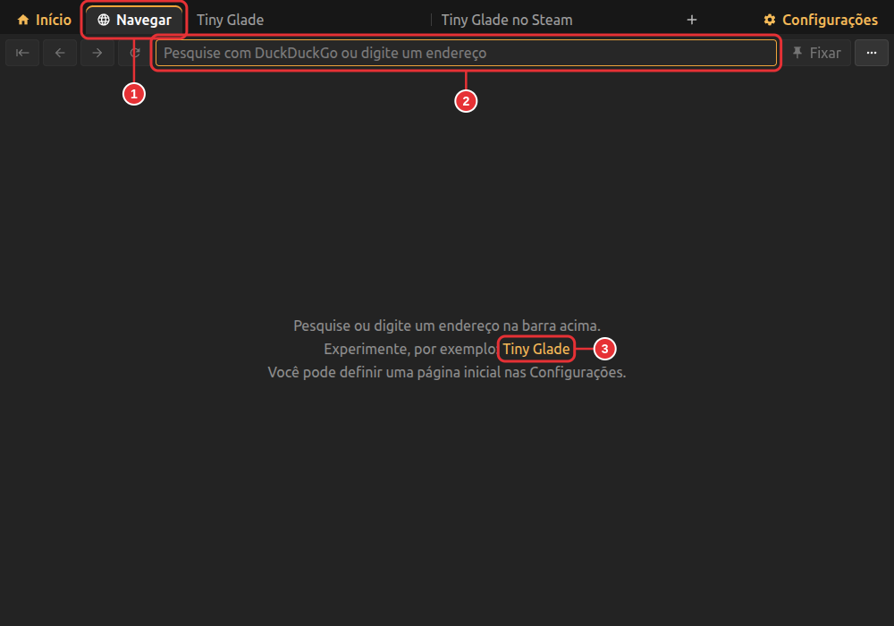
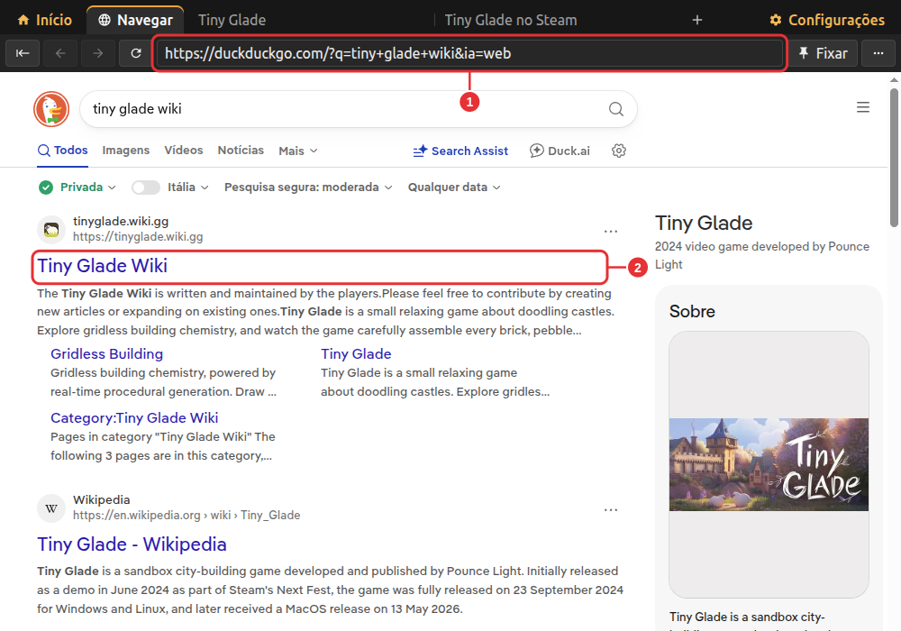
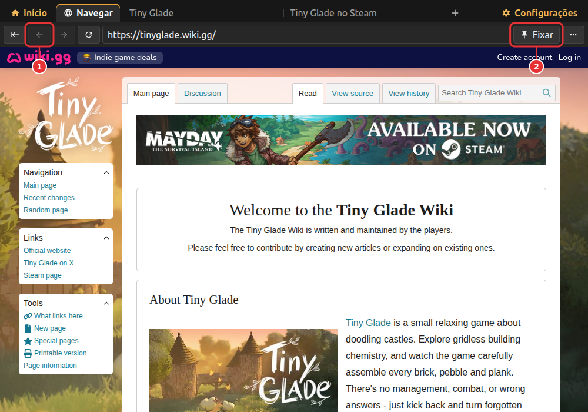
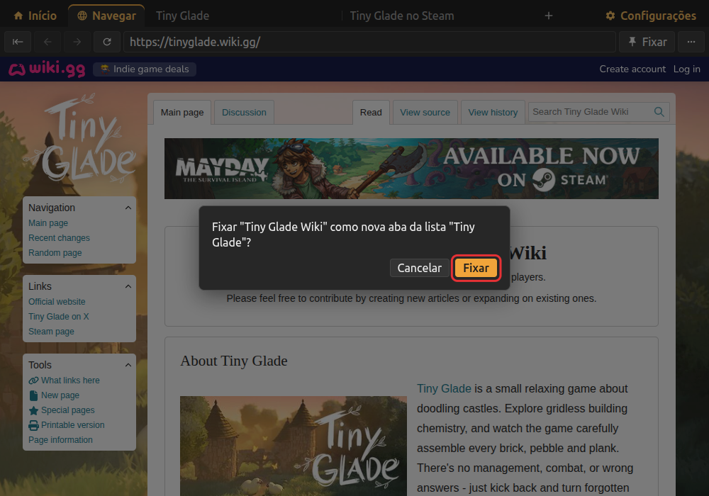
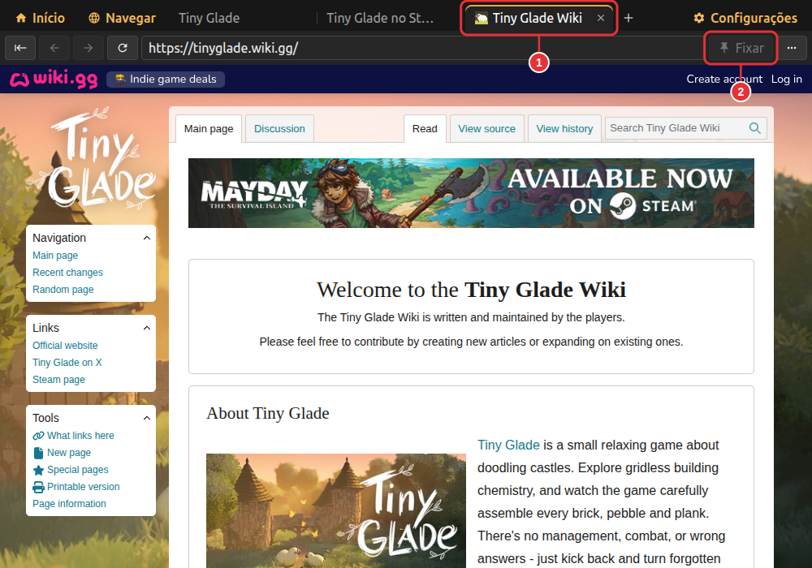
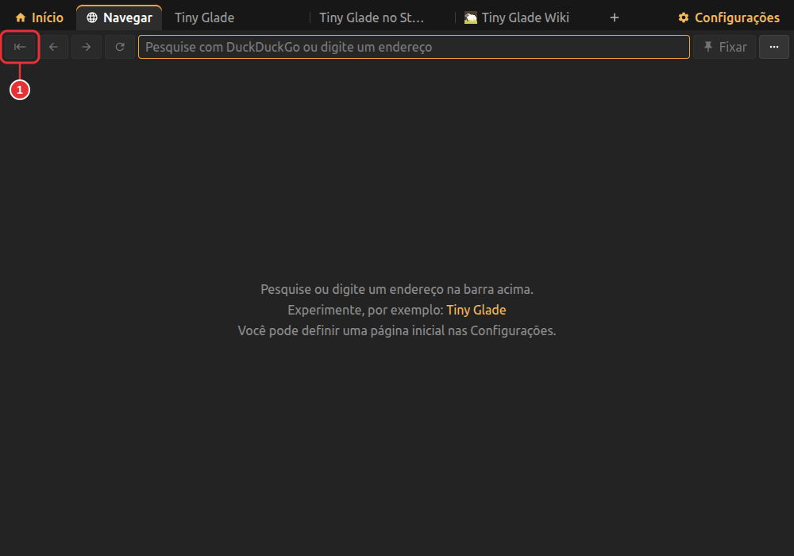

# Navegação livre para pesquisar, encontrar e fixar páginas

Na aba **Navegar**, você pode pesquisar e abrir qualquer página sem adicioná-la à lista. Se quiser guardar a página, **Fixar** a transforma em uma aba da lista do jogo.

Vamos continuar o exemplo de [Primeiros passos](getting-started.md). O overlay está aberto sobre **Tiny Glade**, a lista já tem dois sites e vamos procurar uma wiki do jogo.

Nas capturas de tela, os elementos citados no texto são destacados por um quadro vermelho; números como ❶ no texto indicam o elemento com o mesmo número na captura.

## 1. Abra a aba Navegar

Clique em **Navegar** ❶, logo ao lado de Início. No **campo de endereço** ❷, digite um endereço (basta `example.com`) ou o texto que quer pesquisar. O overlay sugere o **nome do jogo** ❸ como exemplo. Clique nele para pesquisar.

## 2. Pesquise

Digite `tiny glade wiki` e pressione Enter. Os resultados abrem na aba. O **campo de endereço** ❶ mostra o endereço da página de resultados.

Você escolhe o mecanismo de pesquisa nas Configurações, na seção *Comportamento*. As opções são Google, Bing, DuckDuckGo, Brave Search, Ecosia, Startpage ou um endereço personalizado. Aqui usamos o DuckDuckGo.

Clique no resultado que quiser, neste caso **Tiny Glade Wiki** ❷.

## 3. Fixe a página

A página abre na aba Navegar e funciona como em um navegador. **Voltar** ❶ retorna aos resultados. Para guardar a página, clique em **Fixar** ❷.

O overlay pede confirmação. Clique em **Fixar**.

## 4. A página vira uma aba da lista

A página e seu histórico viram uma **nova aba** ❶ no fim da lista de Tiny Glade. Ela estará lá sempre que você abrir o overlay sobre o jogo. **Fixar** ❷ fica desativado porque a página já está na lista.

Você também pode fixar páginas nas abas de sites. A nova aba aparece logo depois da aba de origem. Se a página já tiver uma aba na lista, essa aba fica destacada e Fixar fica desativado.

## 5. A aba Navegar fica livre de novo

Ao voltar a **Navegar**, você encontra a aba vazia, pronta para outra pesquisa. A página fixada foi para uma aba própria. Durante a navegação, **Voltar à página inicial** ❶ fecha a página aberta e mostra a tela vazia.

Nas Configurações, em *Comportamento*, você pode definir a **Página inicial da navegação livre** para que ela abra no lugar da tela vazia.

## Endereços de outros sites nas abas de sites

Você também pode digitar no campo de endereço de uma aba de site. Endereços do mesmo site abrem na própria aba. Endereços de outros sites e pesquisas abrem em Navegar após uma confirmação. A aba original mantém a página.
