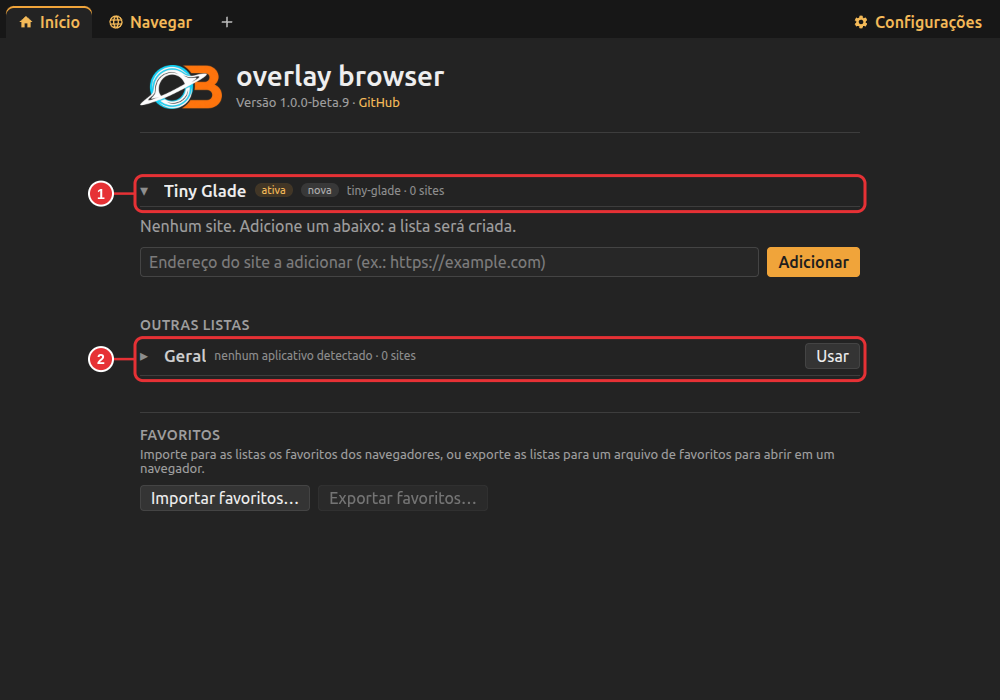
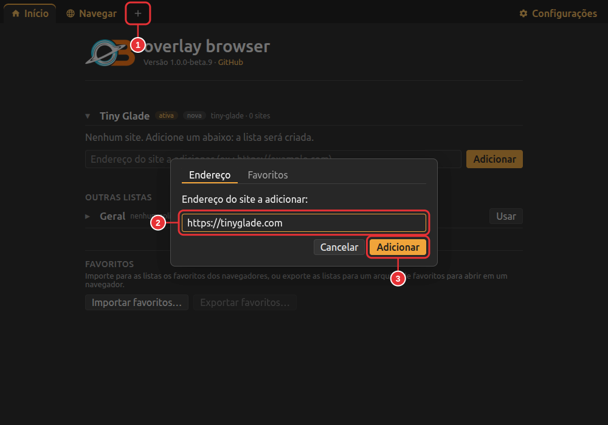
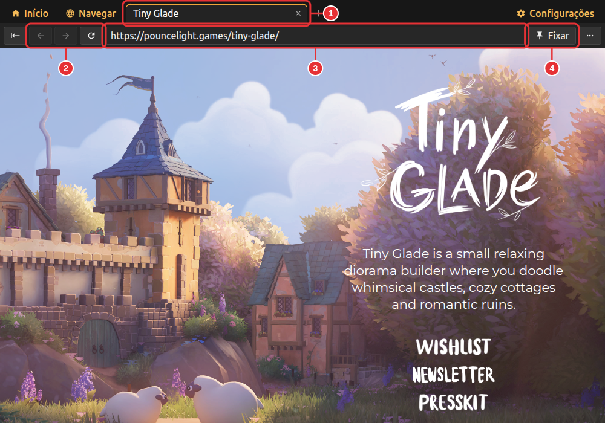
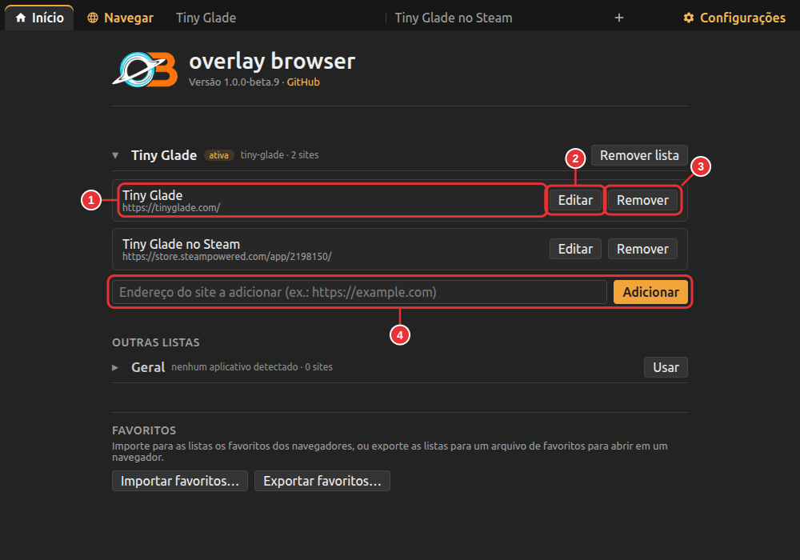
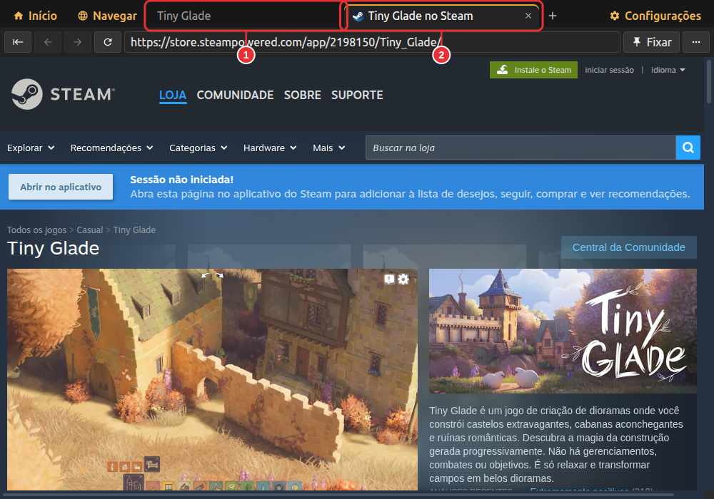

# Primeiros passos para ter os sites do seu jogo à mão

Neste guia, você abre o Overlay Browser enquanto joga **Tiny Glade**, adiciona dois sites úteis e aprende a exibi-los e ocultá-los sem sair do jogo.

Nas capturas de tela, os elementos citados no texto são destacados por um quadro vermelho; números como ❶ no texto indicam o elemento com o mesmo número na captura.

## 1. Inicie o aplicativo

Inicie o Overlay Browser. A janela **permanece oculta** e o aplicativo fica na área de notificação, perto do relógio. Ele não aparece na barra de tarefas nem no Alt+Tab.

Em seguida, inicie o jogo no modo janela ou janela sem bordas.

## 2. Abra o overlay sobre o jogo

Enquanto joga, pressione **Win+F10** (Super+F10 no Linux, Cmd+Shift+Espaço no macOS). O overlay aparece sobre o jogo e abre em **Início**.

O overlay reconheceu o jogo. No topo aparece a lista **Tiny Glade** ❶, *ativa* e ainda *nova*. Cada jogo tem sua própria lista, criada quando você adiciona o primeiro site. Em *Outras listas* fica a lista **Geral** ❷, usada quando nenhum jogo está aberto. Clique em **Usar** para ativá-la manualmente.

## 3. Adicione um site

Clique em **+** ❶ na barra superior, digite o **endereço** do site ❷ (basta `tinyglade.com`) e clique em **Adicionar** ❸.

O site abre na própria **aba** ❶, que recebe o título da página. Use **×** para fechá-la. Abaixo fica a barra de navegação, como em um navegador. Os botões **Voltar**, **Avançar** e **Recarregar** ❷ controlam a página. No campo de **endereço** ❸, você pode digitar outro endereço e pressionar Enter. **Fixar** ❹ transforma a página que você encontrou em uma nova aba.

## 4. Adicione outros sites pelo Início

Volte para **Início** para ver os sites da lista. Clique no **nome do site** ❶ para abri-lo, em **Editar** ❷ para mudar o endereço (Enter salva e Esc cancela) ou em **Remover** ❸ para tirá-lo da lista. Para adicionar um site, digite o endereço no **campo abaixo da lista** ❹ e clique em *Adicionar*. Neste exemplo, adicionamos a página do jogo no Steam.

## 5. Alterne entre os sites

Cada site tem sua própria aba. Aqui estão o **site oficial** ❶ e a **página do Steam** ❷, que está aberta agora. Ao voltar a uma aba, você encontra a página onde a deixou.

## 6. Volte ao jogo

Pressione **Win+F10** de novo para ocultar o overlay ou clique na janela do jogo. Por padrão, o overlay se oculta ao perder o foco. Você pode desativar isso nas Configurações.

Na próxima vez que abrir o overlay sobre Tiny Glade, você verá a lista dele na última aba que usou. Se abrir sobre outro jogo, verá a lista daquele jogo.
