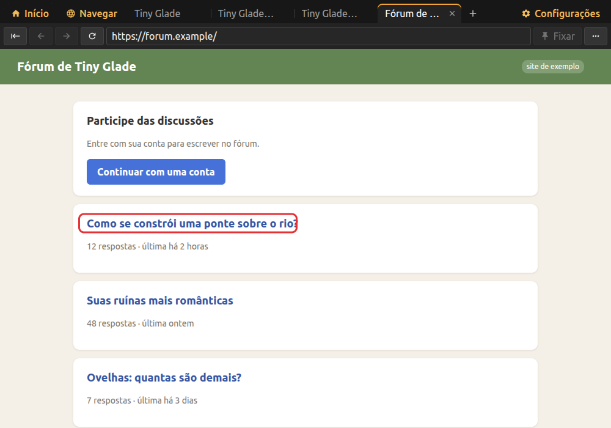
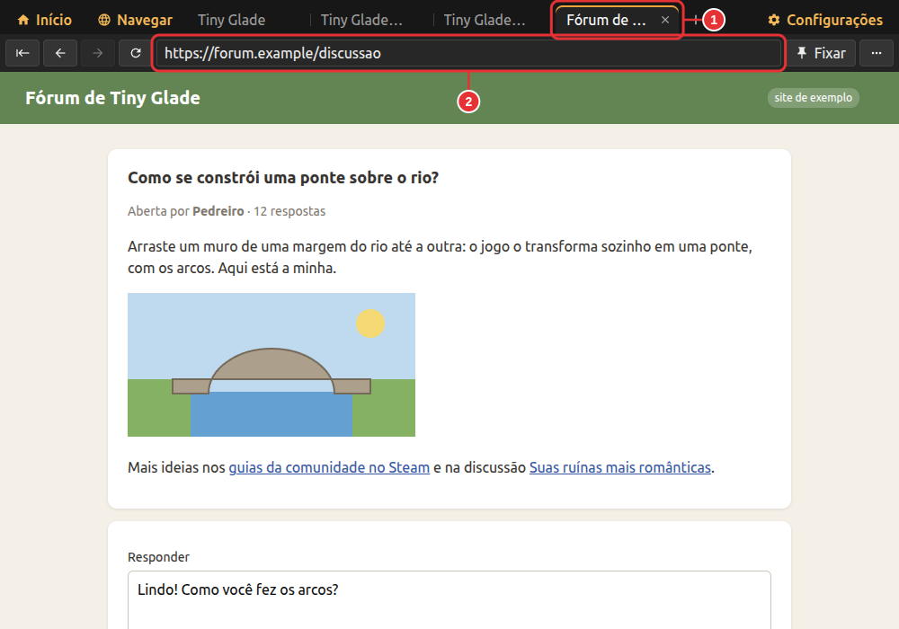
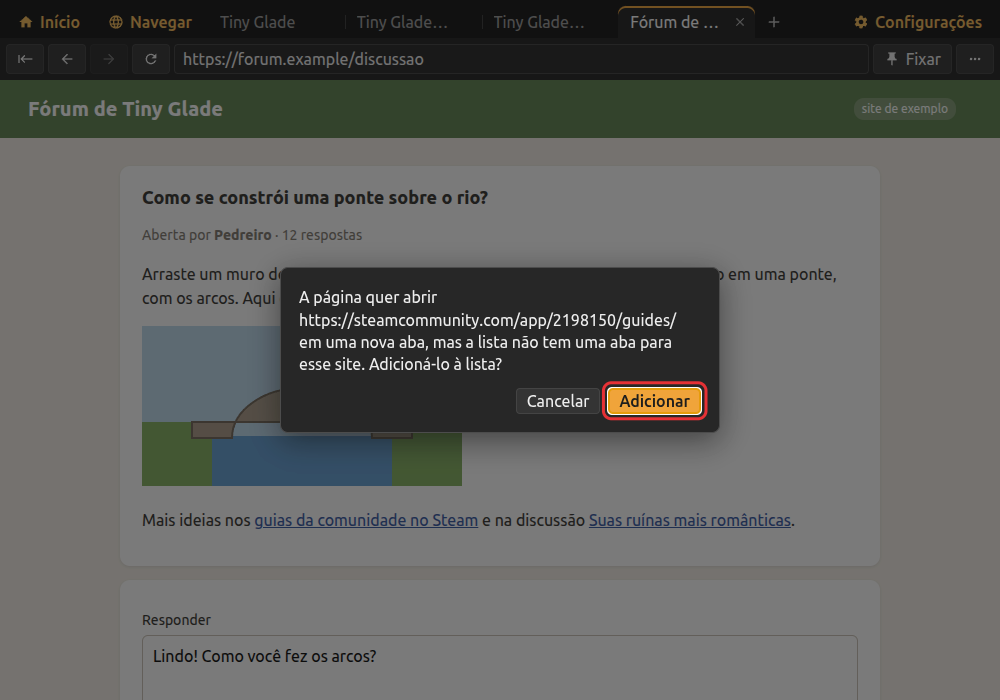
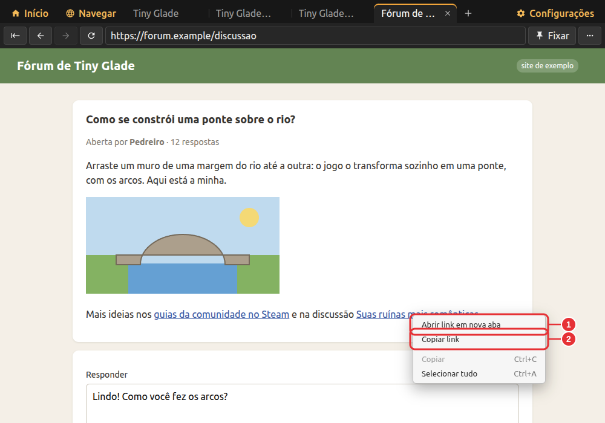
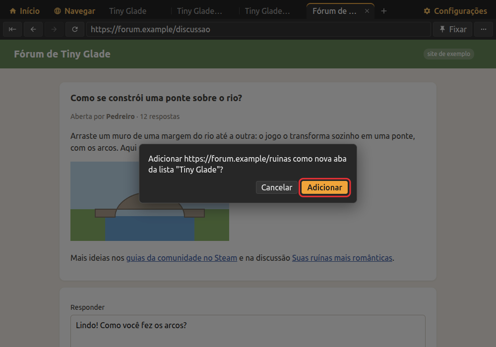
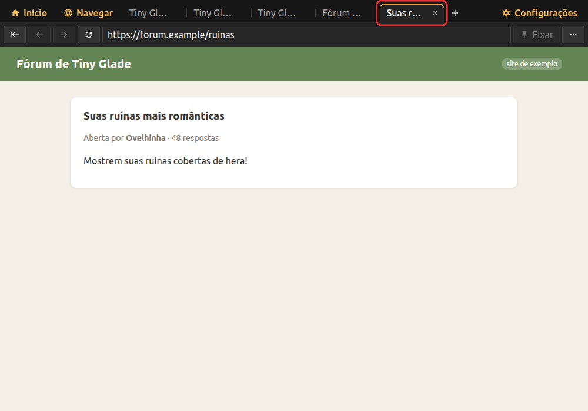
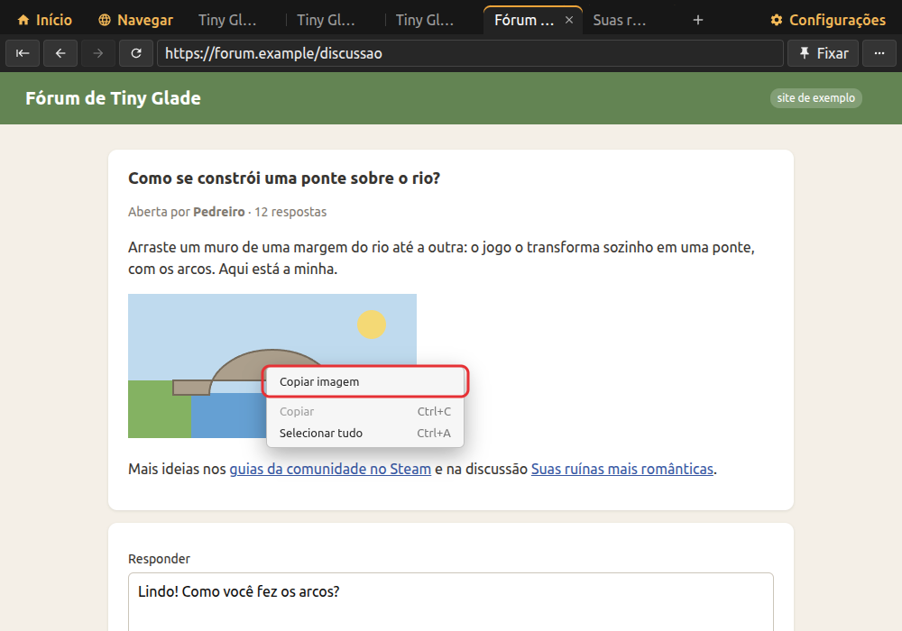
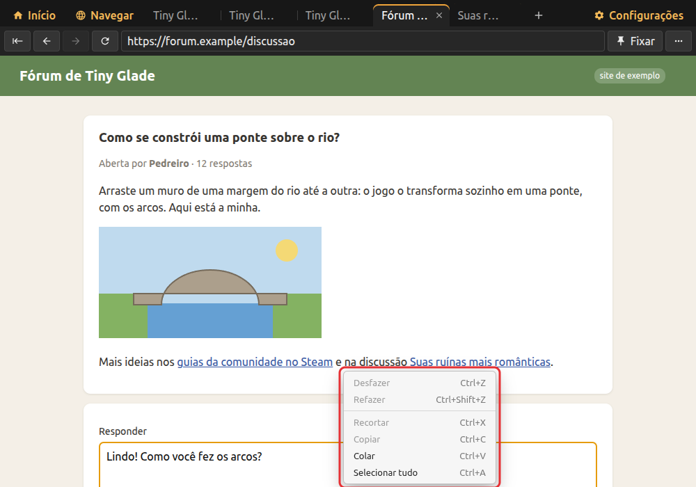

# Links, novas abas e menu de contexto

Em um navegador, muitos links abrem em uma nova aba. No overlay, as abas correspondem aos sites da lista. Esses links abrem na aba do site de origem ou, após confirmação, em uma nova aba. Com o botão direito, você pode abrir links em novas abas e copiar links, imagens ou texto.

A lista de **Tiny Glade** inclui um fórum, um **site de exemplo** para este guia. Veja [Entrar em um site e excluir seus cookies](signing-in.md).

Nas capturas de tela, os elementos citados no texto são destacados por um quadro vermelho; números como ❶ no texto indicam o elemento com o mesmo número na captura.

## 1. Um link que o site abre em uma nova aba

Alguns links são feitos para abrir em outra aba, como o desta discussão. O mesmo vale para links clicados com Ctrl ou com o botão do meio do mouse.

## 2. O mesmo site abre na própria aba

Se o link levar ao mesmo site, ele abre na **aba do site** ❶, no lugar da página anterior. O **endereço** ❷ passa a mostrar o da discussão. **Voltar** recupera a página anterior.

Se a lista tiver várias abas do mesmo site, o link abre na aba de origem.

## 3. Outro site pede confirmação

Se o link levar a um site sem aba na lista, como os guias da comunidade no Steam, o overlay pergunta se você quer adicioná-lo à lista. **Adicionar** inclui e abre o site. **Cancelar** mantém a página atual.

Links abertos a partir de **Navegar** ficam nessa aba. Veja [Navegação livre](free-browsing.md).

## 4. Clique com o botão direito em um link

Ao clicar com o botão direito em um link, o menu mostra **Abrir link em nova aba** ❶ e **Copiar link** ❷, que copia o endereço.

**Abrir link em nova aba** pede confirmação antes de incluir o link na lista. Clique em **Adicionar**.

O link abre em uma **nova aba** logo após a aba de origem. Se já houver uma aba com esse endereço, o overlay exibe a aba existente.

## 5. Clique com o botão direito em imagens e texto

Em uma imagem, use **Copiar imagem** para colá-la, por exemplo, em uma conversa. No texto de uma página, aparecem **Copiar** para o texto selecionado e **Selecionar tudo**.

Em campos de texto, como o campo de resposta do fórum ou o de endereço, aparecem **Desfazer**, **Refazer**, **Recortar**, **Copiar**, **Colar** e **Selecionar tudo**. Opções indisponíveis aparecem em cinza, como *Copiar* quando não há texto selecionado.

