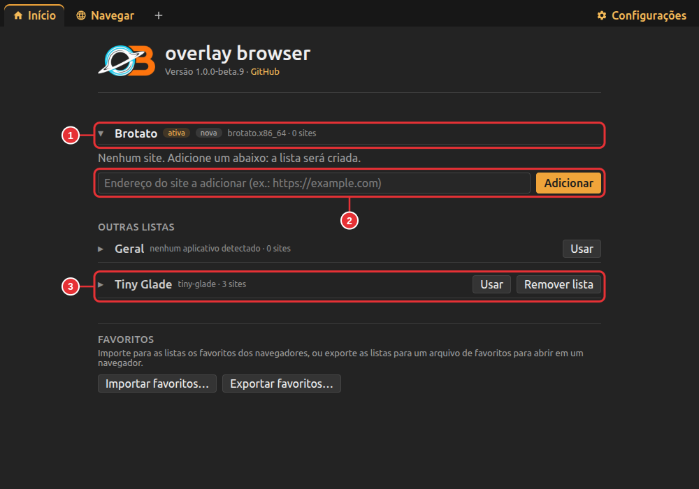
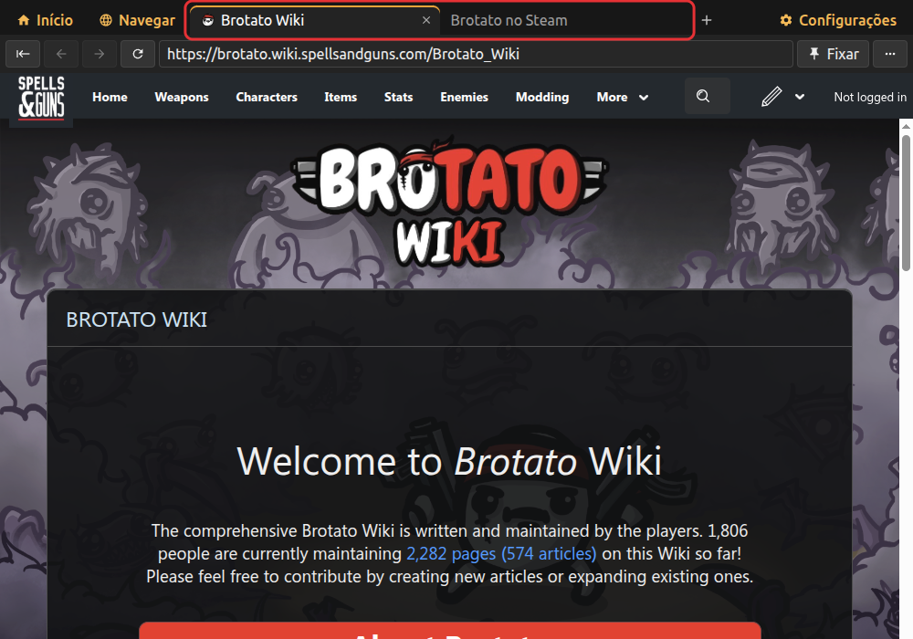
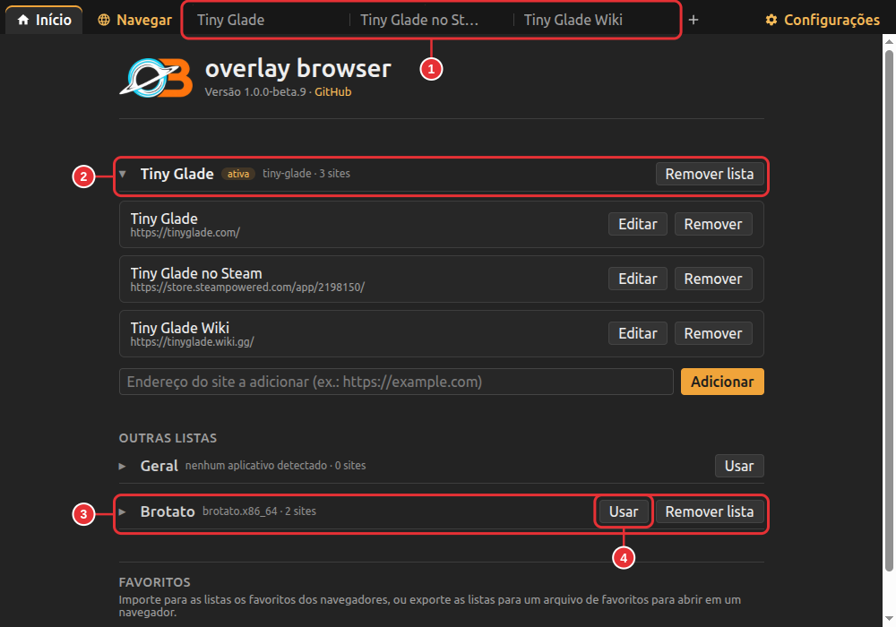
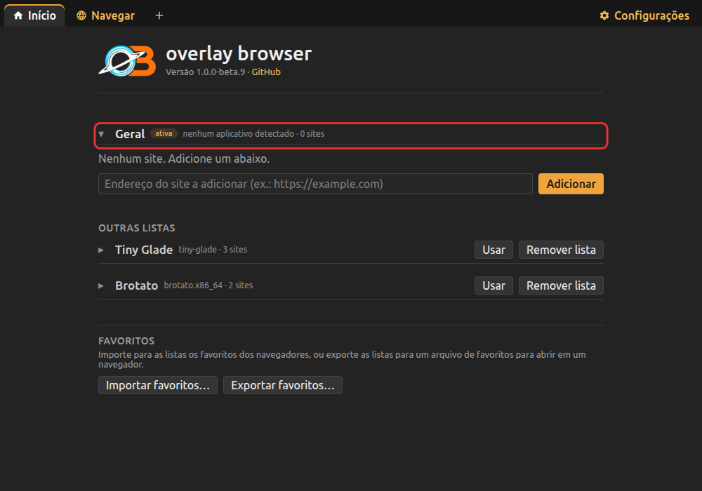
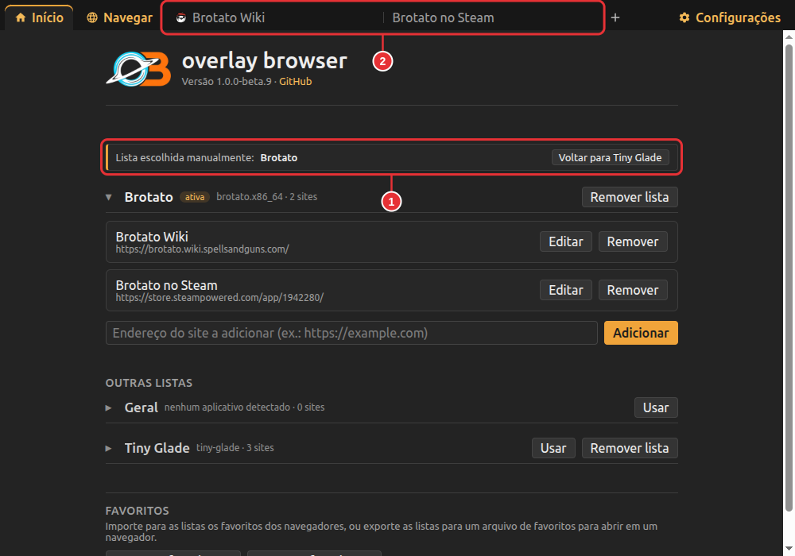
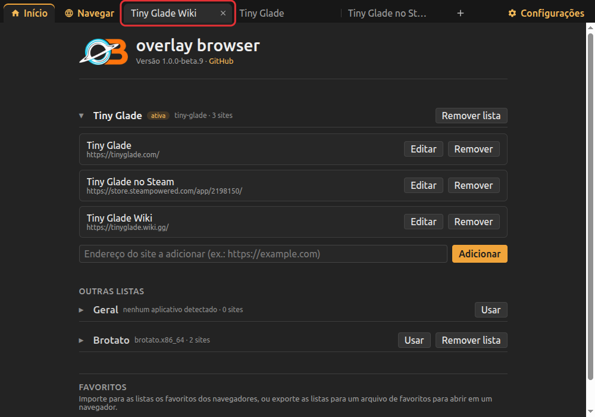
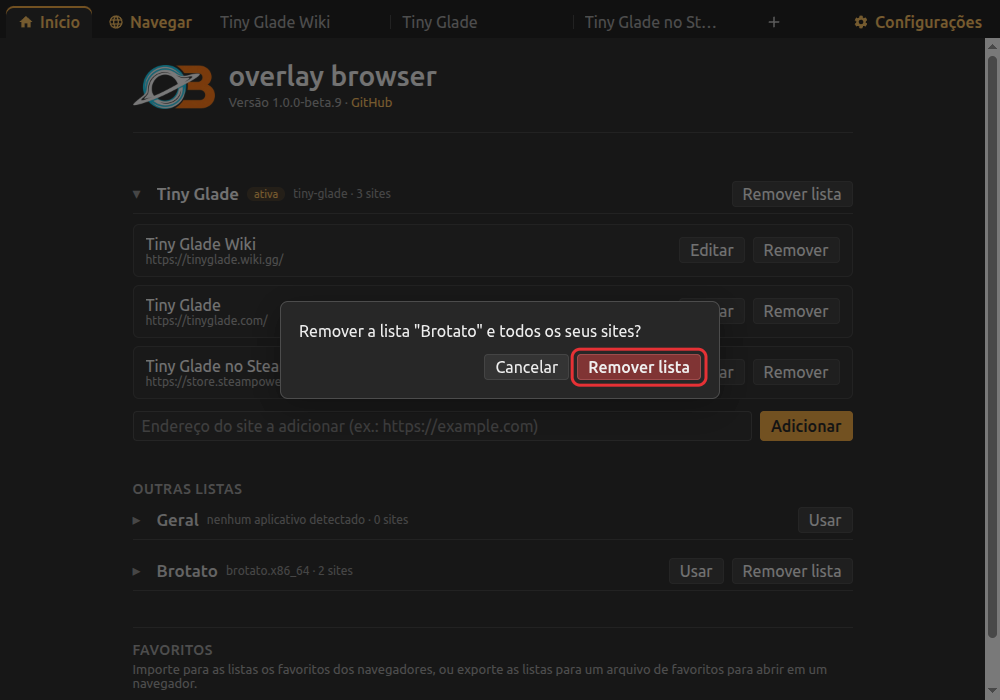

# Uma lista por jogo

O Overlay Browser reconhece o jogo sobre o qual você o abre e mostra os sites desse jogo. Cada jogo tem a própria **lista**. Depois de [Primeiros passos](getting-started.md) e [Navegação livre](free-browsing.md), a lista de **Tiny Glade** já tem três sites. Agora vamos jogar **Brotato**.

Nas capturas de tela, os elementos citados no texto são destacados por um quadro vermelho; números como ❶ no texto indicam o elemento com o mesmo número na captura.

## 1. Um jogo novo, uma lista nova

Abra o overlay enquanto joga Brotato. No topo de Início aparece a **lista de Brotato** ❶, *ativa* e ainda *nova*. Ao lado do nome você vê o programa reconhecido e o número de sites. Adicione um site no **campo abaixo da lista** ❷ ou pelo **+** da barra superior. A lista é criada junto com o primeiro site. A **lista de Tiny Glade** ❸ está recolhida em *Outras listas*. Clique nela para ver seus sites.

Aqui adicionamos a wiki de Brotato e a página do jogo no Steam. A barra mostra apenas as abas de Brotato.

## 2. Cada jogo recupera seus sites

Volte a Tiny Glade e abra o overlay. A barra mostra as **abas de Tiny Glade** ❶ e a **lista de Tiny Glade** ❷ está ativa. A **lista de Brotato** ❸ foi para *Outras listas*. **Usar** ❹ a ativa manualmente (veja o passo 4). Cada lista reabre na última aba que você usou.

## 3. A lista Geral

O overlay oferece uma lista para qualquer programa sobre o qual você o abra. Quando ele não reconhece um aplicativo, a **lista Geral** fica ativa. Ela serve para sites sem ligação com um programa específico. Funciona como as outras e não pode ser removida.

## 4. Escolha uma lista manualmente

Você pode querer ver os sites de outro jogo, por exemplo a wiki de Brotato enquanto Tiny Glade está aberto. Clique em **Usar** ao lado da lista desejada (❹ na captura do passo 2).

A lista fica ativa como **Lista escolhida manualmente** ❶ mesmo se você abrir o overlay sobre outros jogos. Clique em **Voltar para Tiny Glade** para voltar à lista do jogo sobre o qual o overlay está aberto naquele momento. A barra mostra as **abas da lista escolhida** ❷.

## 5. Reordene abas e sites

Arraste uma aba na barra para movê-la. Aqui a Tiny Glade Wiki passa para a primeira posição.

Você também pode arrastar os sites em Início. A ordem dos sites e a das abas é a mesma.

## 6. Remova uma lista

**Remover lista**, ao lado do nome da lista, exclui a lista e todos os seus sites depois de pedir confirmação.

Ao adicionar um site enquanto joga Brotato de novo, a lista será recriada.
