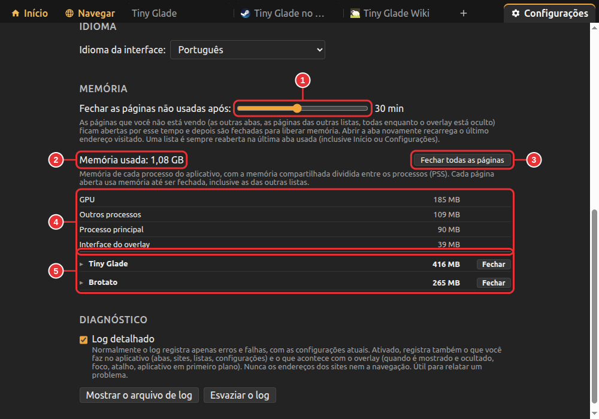
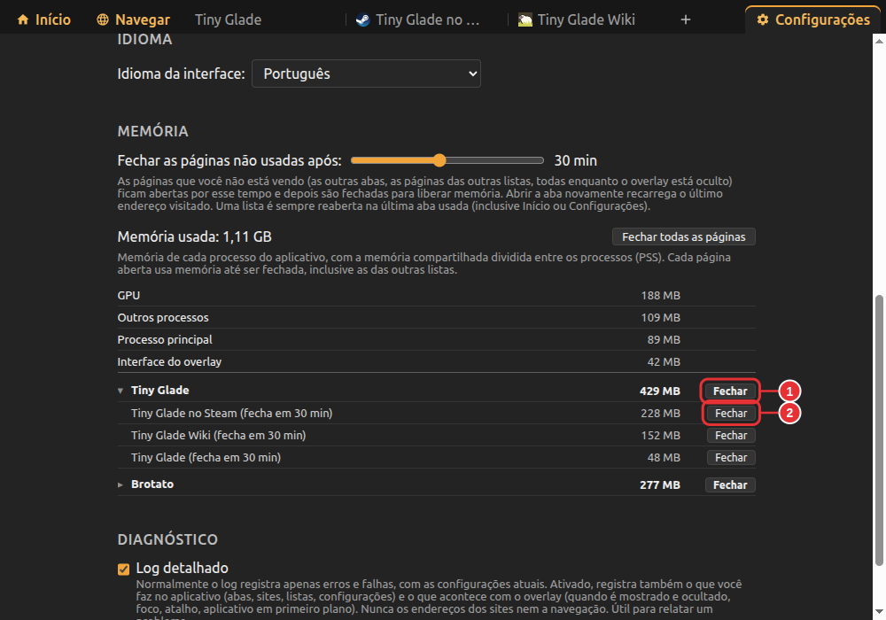
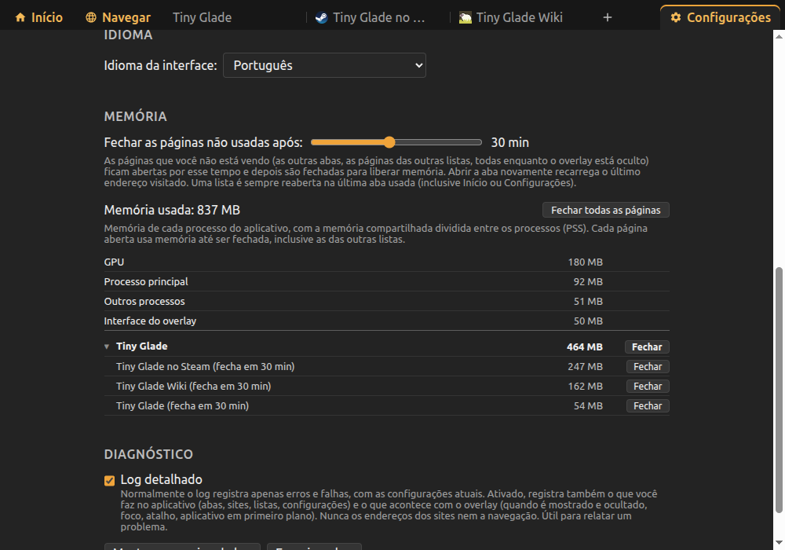

# Memória e páginas fechadas

Cada página aberta no Overlay Browser usa memória, como em um navegador, mesmo quando você não está olhando para ela. As páginas das outras listas também ficam abertas. Para deixar memória para o jogo, o overlay **fecha automaticamente as páginas que você deixou de usar**. Nas Configurações, você pode consultar o consumo de memória e fechar páginas manualmente.

Neste exemplo, há várias páginas abertas nas listas de **Tiny Glade** e **Brotato**. Veja [Uma lista por jogo](lists-per-game.md).

Nas capturas de tela, os elementos citados no texto são destacados por um quadro vermelho; números como ❶ no texto indicam o elemento com o mesmo número na captura.

## 1. Por que uma página recarrega

As páginas que você não está vendo ficam abertas por um tempo e depois fecham. Isso se aplica às outras abas, às outras listas e a todas as páginas enquanto o overlay estiver oculto. Quando você reabre uma aba, a página **recarrega a partir do último endereço visitado**. Você recupera a página, mas pode perder a posição da rolagem ou um formulário preenchido pela metade.

A página que você está vendo continua aberta.

## 2. A seção Memória

Abra **Configurações** e role até *Memória*.

- **Fechar as páginas não usadas após** ❶ define o tempo de espera de 5 a 60 minutos. O padrão é 30 minutos. Se houver pouca memória livre ou o jogo consumir muita memória, use um tempo menor.
- **Memória usada** ❷ mostra a memória de todo o aplicativo.
- **Fechar todas as páginas** ❸ fecha imediatamente as páginas abertas de todas as listas.
- **Processos do aplicativo** ❹ inclui a interface do overlay, o processo principal, os gráficos (GPU) e outros processos. Eles sempre usam memória.
- **Páginas agrupadas por lista** ❺ mostra a memória das páginas abertas de cada lista. **Fechar** fecha todas as páginas da lista.

## 3. Páginas de uma lista

Clique no nome da lista para ver as páginas abertas, quanta memória cada uma usa e quanto tempo falta para fechar. **Fechar** ao lado da lista ❶ fecha todas as páginas dela. **Fechar** ao lado de uma página ❷ fecha só aquela.

Algumas páginas compartilham um processo, como páginas do mesmo site em listas diferentes. Elas aparecem em uma linha fora dos grupos e são fechadas juntas. A memória só é liberada quando todas fecham.

## 4. Depois de fechar as páginas

Aqui fechamos as páginas de Brotato. O grupo saiu da tabela e a memória usada diminuiu. As abas permanecem na lista e recarregam as páginas quando você as abre.

