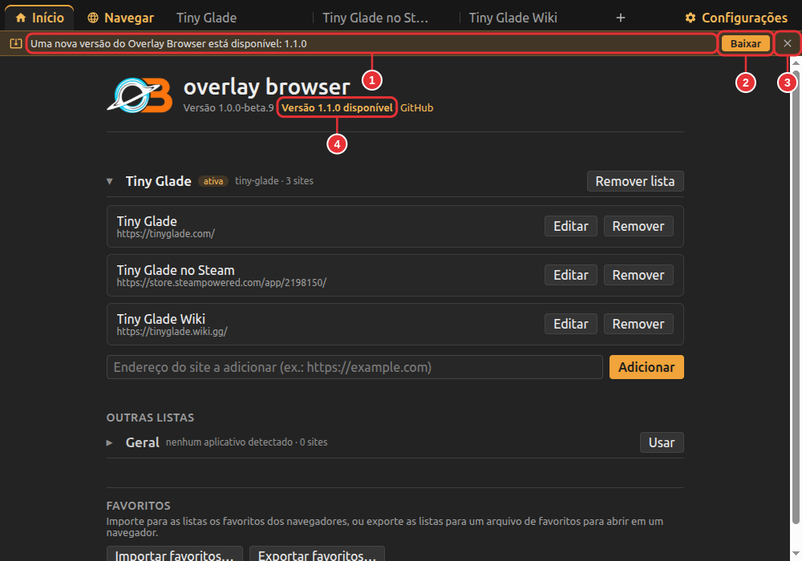
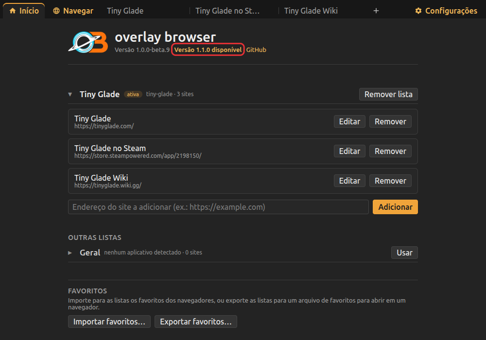
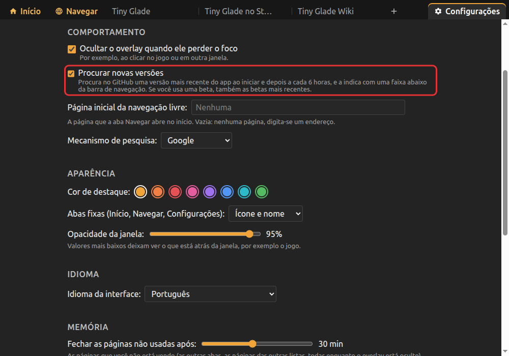

# Novas versões

O Overlay Browser verifica se há uma nova versão e avisa você. Você escolhe quando baixar e instalar a atualização.

Nas capturas de tela, os elementos citados no texto são destacados por um quadro vermelho; números como ❶ no texto indicam o elemento com o mesmo número na captura.

## 1. O aviso de nova versão

Quando sai uma nova versão, aparece uma **faixa** ❶ abaixo da barra superior com o número da versão. **Baixar** ❷ abre no navegador do sistema a página de onde você pode baixar o arquivo para seu sistema. Veja a instalação no [README](../../README.md). **×** ❸ fecha a faixa em definitivo para essa versão.

A nova versão também aparece no topo de **Início** ❹ ao lado da que você usa. Clique nela para abrir a mesma página.

Depois de fechar a faixa, a nova versão continua em Início até você instalar a atualização.

## 2. Quando o aplicativo verifica

O aplicativo consulta os lançamentos do projeto no GitHub logo após iniciar e a cada seis horas. Se você usa uma versão beta, ele também avisa sobre betas mais recentes. Nos demais casos, avisa apenas sobre versões finais.

Para parar de receber os avisos, desative **Procurar novas versões** em **Configurações**, na seção *Comportamento*. A edição da Microsoft Store recebe atualizações pela loja e não oferece essa opção.

