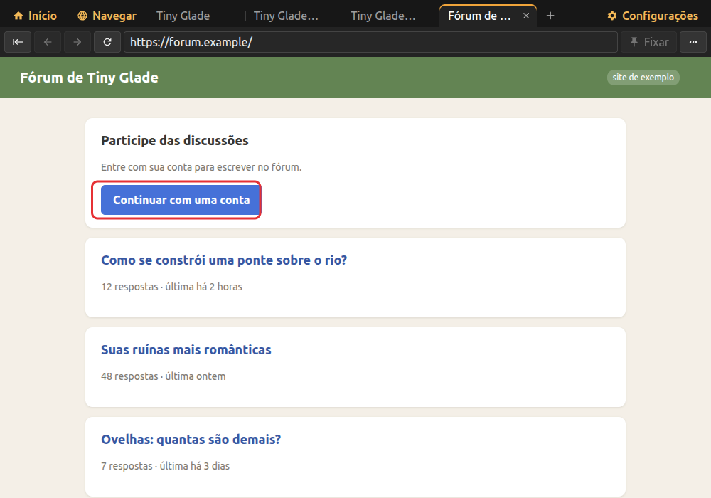
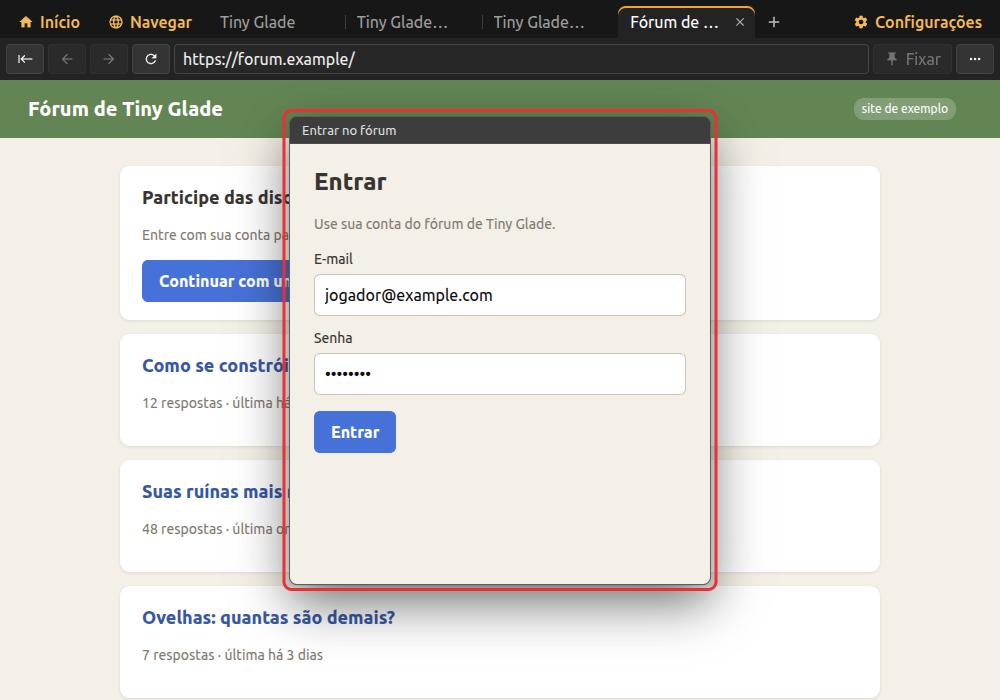
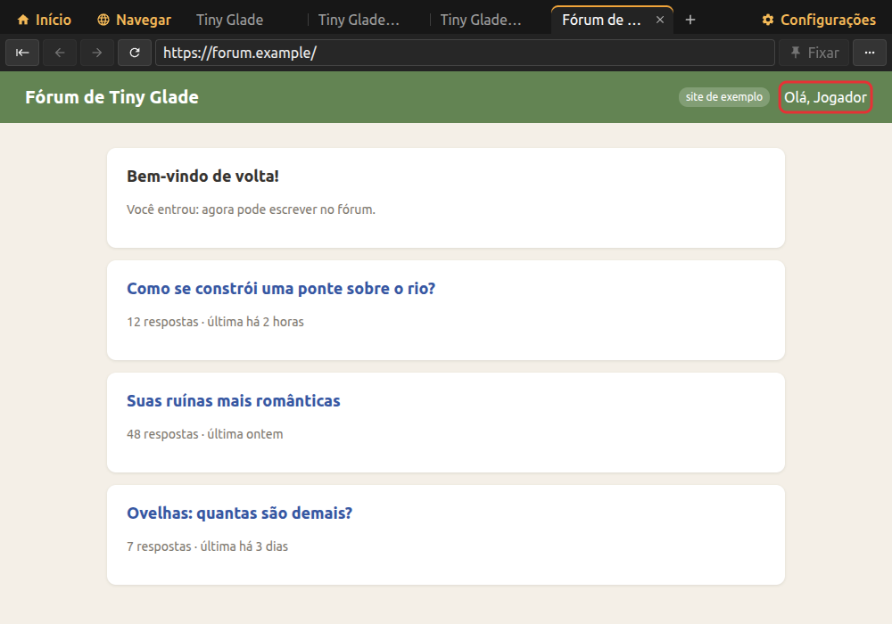
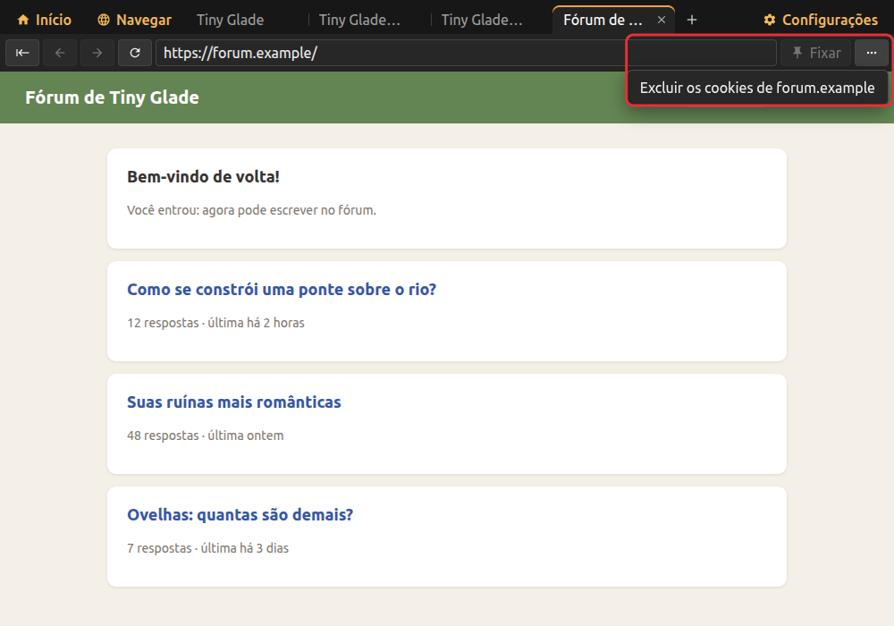
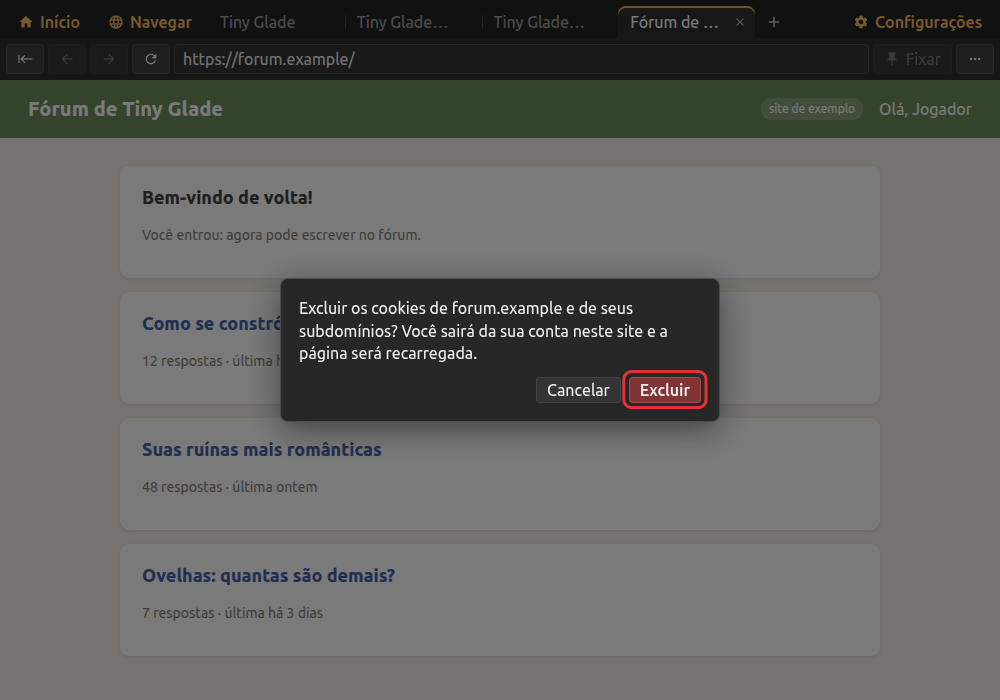

# Entrar em um site e excluir seus cookies

Muitos sites de jogos, como fóruns, wikis ou ferramentas para planejar builds, funcionam melhor com uma conta ou exigem que você entre. No overlay, você entra como em um navegador e a sessão fica salva. Se um site parar de funcionar direito ou você quiser sair da conta, pode excluir os cookies dele.

A lista de **Tiny Glade** também inclui um fórum. É um **site de exemplo** feito para este guia. O acesso funciona como em sites reais, por exemplo com *Continuar com o Google*.

Nas capturas de tela, os elementos citados no texto são destacados por um quadro vermelho; números como ❶ no texto indicam o elemento com o mesmo número na captura.

## 1. Entre com sua conta

Abra a aba do site e clique no botão de acesso, aqui **Continuar com uma conta**.

O site abre uma **janela de acesso** sobre o overlay. Digite seus dados e confirme.

A janela de acesso faz parte do overlay. Ela fica por cima e se oculta e reaparece junto com ele. Você pode alternar entre as janelas sem ocultá-las. Quando a janela de acesso fecha, o overlay volta a ficar ativo.

## 2. A sessão fica salva

Depois que você entra, a janela fecha e o site mostra sua **conta**.

Você continua na conta mesmo se fechar o overlay ou reiniciar o aplicativo. A mesma sessão vale em todas as listas onde esse site aparece.

## 3. Exclua os cookies de um site

Cookies são dados que o site salva para reconhecer você e manter sua sessão. Você pode excluí-los para **sair da conta**, por exemplo para trocar de conta, ou quando o **site não funciona direito**.

Na aba do site, clique em **…** (*Mais ações*) à direita do endereço e escolha **Excluir os cookies de forum.example**.

Quando o overlay pedir confirmação, clique em **Excluir**. Os cookies do site e dos subdomínios serão excluídos. Os outros sites mantêm seus cookies.

## 4. A página recarrega

Depois da exclusão, a página recarrega. Você saiu da conta e o site oferece a opção de **entrar** novamente.

