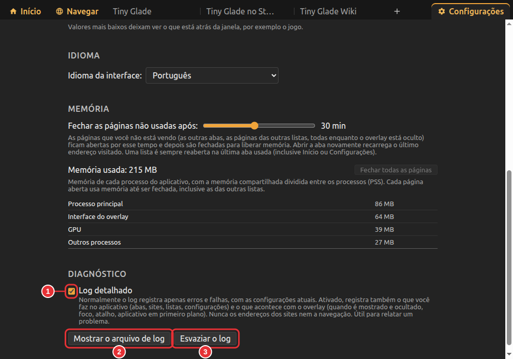
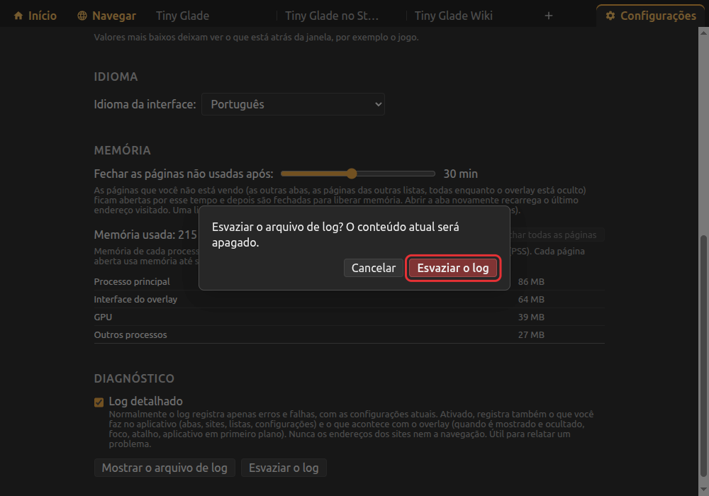

# Solução de problemas

Veja como resolver problemas comuns e coletar informações para relatá-los. Consulte o [README](../../README.md) para os detalhes de Windows, Linux e macOS.

Nas capturas de tela, os elementos citados no texto são destacados por um quadro vermelho; números como ❶ no texto indicam o elemento com o mesmo número na captura.

## 1. A combinação de teclas não funciona

- **Outro programa já usa a combinação.** Se você a escolher nas Configurações, o overlay avisa que a combinação é “inválida ou já em uso” e mantém a anterior. Escolha outra. Veja [Personalize o overlay](customizing.md).
- **O jogo usa a combinação em um comando.** A combinação também chega ao jogo. Escolha uma que não acione nada nele.
- **Linux com Wayland.** A combinação não é detectada enquanto uma janela nativa do Wayland estiver ativa. Use uma sessão X11. Veja *Linux* no [README](../../README.md#linux).
- **Teclas de função no macOS.** Por padrão, F1 a F12 controlam brilho, volume e outros ajustes. Pressione-as junto com **fn** ou altere a configuração do teclado. Veja *macOS* no [README](../../README.md#macos).

Você também pode exibir o overlay pelo ícone na área de notificação.

## 2. Não encontro o ícone do aplicativo

O aplicativo fica na área de notificação, perto do relógio. Ele não aparece na barra de tarefas nem no Alt+Tab.

- **Windows** – Se o ícone estiver oculto, clique na seta **^** e arraste o ícone para a barra de tarefas para que fique visível.
- **Linux com GNOME** – Você precisa da extensão *AppIndicator and KStatusNotifierItem Support*. Se o clique no ícone abrir um menu, escolha *Mostrar*.
- **macOS** – O ícone fica no canto direito da barra de menus.

## 3. O overlay não aparece sobre o jogo ou está opaco

- **O jogo cobre o overlay.** Alguns jogos em tela cheia exclusiva cobrem todas as janelas. Mude o jogo para o modo *janela sem bordas*.
- **A janela está opaca no Linux.** A transparência requer um gerenciador de janelas com composição ativa, como Cinnamon, KDE, GNOME ou Xfce com composição ativada.

## 4. Um site falha ou a página recarrega

- **O site não funciona direito ou você quer sair da conta.** Exclua os cookies pelo menu **…**. Veja [Entrar em um site e excluir seus cookies](signing-in.md).
- **A página recarrega ao voltar para a aba.** Páginas sem uso são fechadas depois de um tempo para liberar memória. Veja [Memória e páginas fechadas](memory.md).
- **Você quer começar do zero.** Feche o aplicativo e apague o arquivo de preferências. Veja *Preferences and uninstalling* no [README](../../README.md#preferences-and-uninstalling).

## 5. Colete informações para relatar um problema

Se o problema persistir, relate-o na [página de problemas do projeto](https://github.com/siculo/overlay-browser/issues). O arquivo de log ajuda a entender o que aconteceu.

Em **Configurações**, abra a seção *Diagnóstico*.

- **Log detalhado** ❶ normalmente registra erros e falhas com as configurações atuais. Quando ativado, também registra o que você faz no aplicativo (abas, sites, listas e configurações) e o que acontece com o overlay (exibição, ocultação, foco, combinação de teclas e aplicativo em primeiro plano). Ative a opção e repita os passos que causam o problema.
- **Mostrar o arquivo de log** ❷ abre a pasta do arquivo `overlay.log` para você anexá-lo ao relato.
- **Esvaziar o log** ❸ apaga o conteúdo, por exemplo para registrar apenas o problema que você quer relatar.

O log não guarda as teclas que você pressiona nem sua navegação, incluindo endereços e títulos de páginas. Os sites são identificados apenas pela posição na lista.

**Esvaziar o log** pede confirmação antes de apagar o conteúdo.

