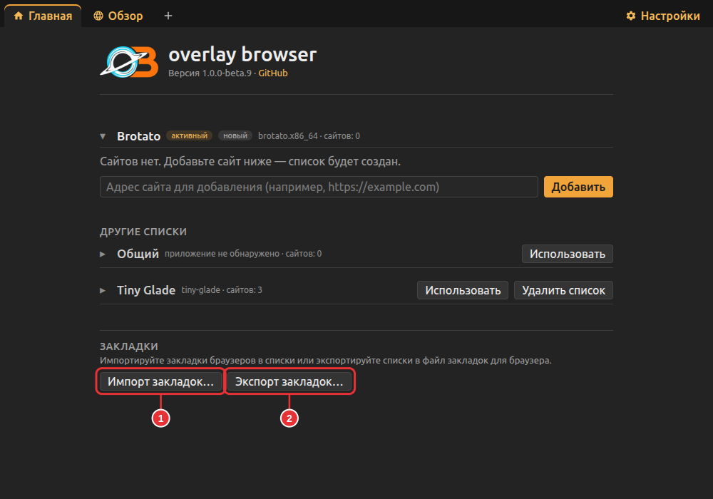
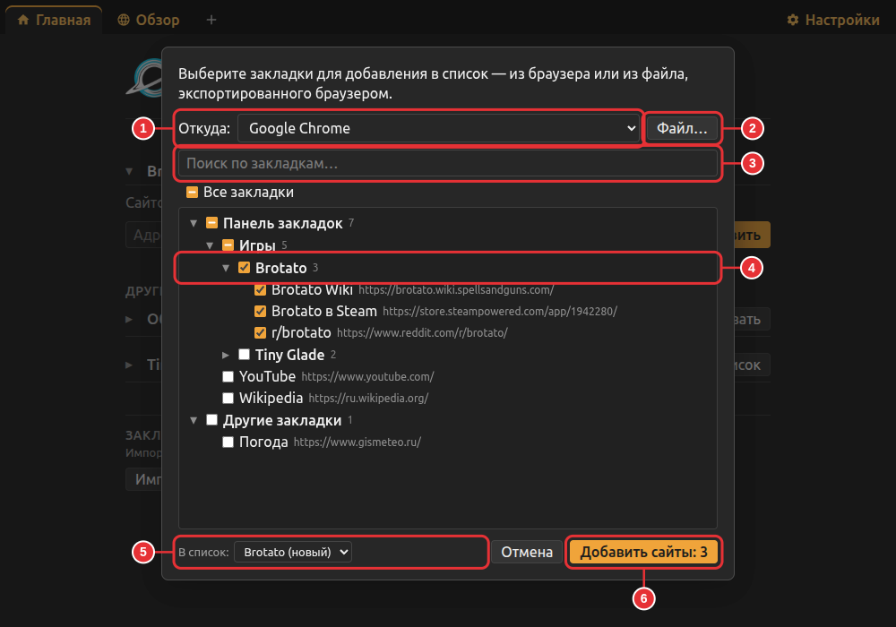
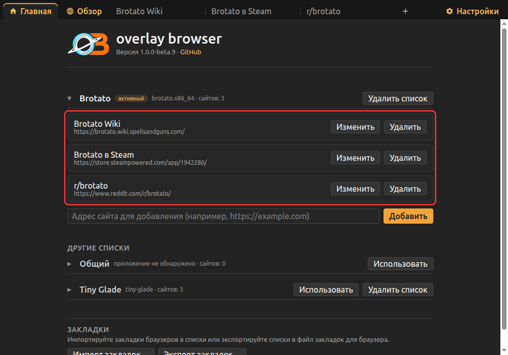
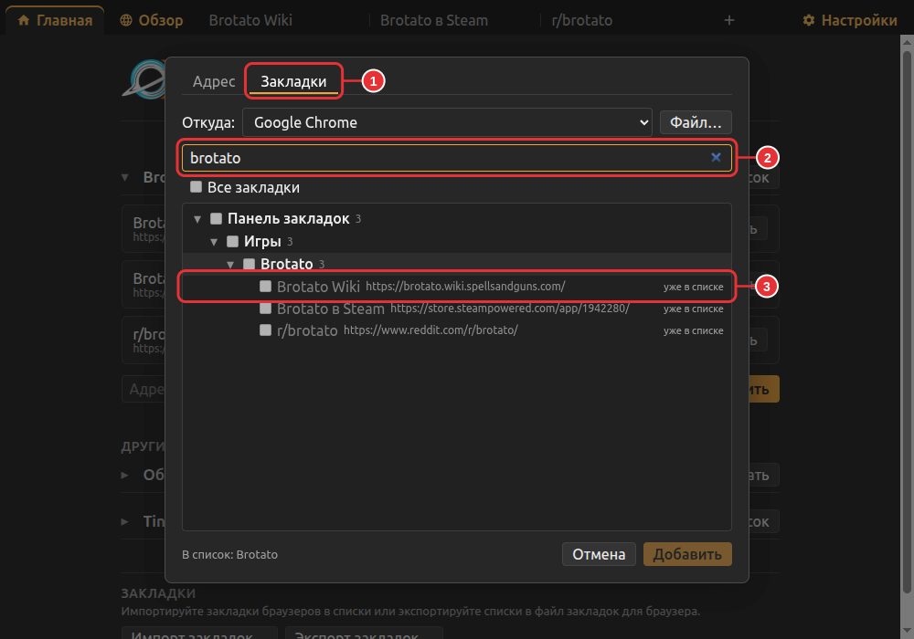
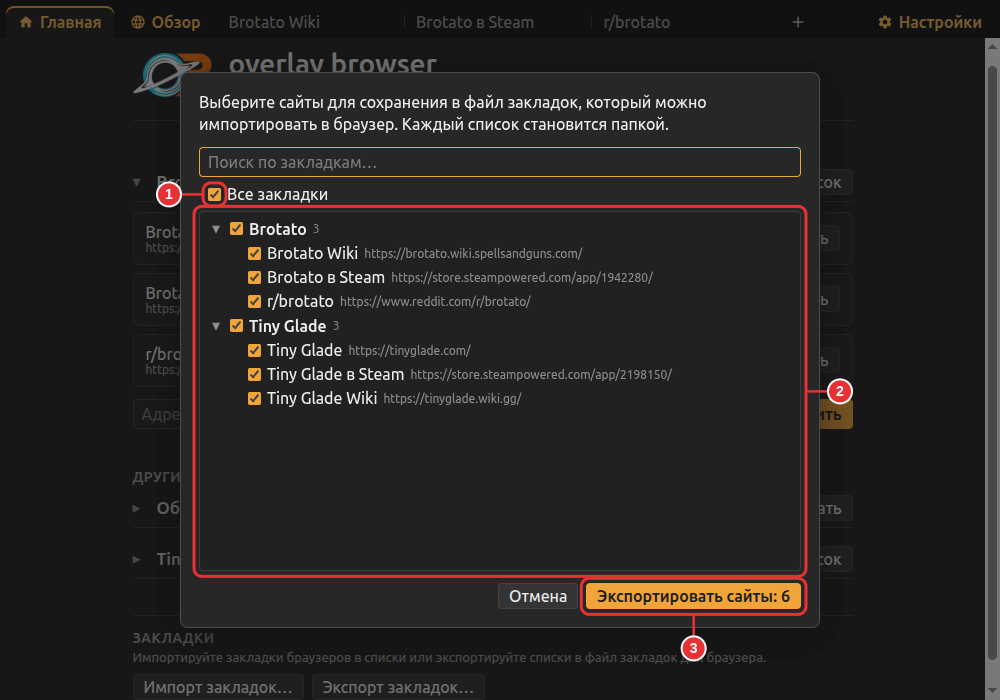

# Импорт и экспорт закладок

Сайты ваших игр уже есть в закладках браузера? Их можно импортировать в списки Overlay Browser без повторного ввода адресов. Списки можно экспортировать в файл закладок для любого браузера.

Оверлей открыт поверх **Brotato**, список которого пока пуст. В списке **Tiny Glade** уже три сайта. См. [У каждой игры свой список](lists-per-game.md).

На снимках экрана элементы, упомянутые в тексте, выделены красной рамкой; номера вроде ❶ в тексте указывают на элемент с тем же номером на снимке.

## 1. Раздел «Закладки» на главной

Внизу вкладки **Главная** находится раздел *Закладки* с кнопками **Импорт закладок…** ❶ и **Экспорт закладок…** ❷.

## 2. Выберите закладки для импорта

Нажмите **Импорт закладок…**. В окне есть несколько элементов.

- **Откуда** ❶ выбирает профиль браузера. Оверлей автоматически находит Chrome, Edge, Brave, Opera, Vivaldi, Chromium, Firefox, LibreWolf и похожие браузеры. Firefox можно оставить открытым. При следующем импорте будет предложен последний выбранный профиль.
- **Файл…** ❷ импортирует HTML-файл, экспортированный из менеджера закладок любого браузера. В macOS доступен только этот способ. Сначала экспортируйте закладки из браузера.
- **Поиск по закладкам…** ❸ находит закладки и папки по названию или адресу.
- **Флажки** ❹ позволяют выбирать отдельные закладки и целые папки. *Все закладки* выбирает их все. В примере отмечаем папку *Brotato*.
- **В список** ❺ задаёт, куда добавлять сайты. Изначально выбран активный список. Если он ещё *новый*, как у Brotato, он будет создан вместе с импортированными сайтами.
- Кнопка **Добавить сайты: 3** ❻ показывает, сколько сайтов будет добавлено.

Закладки появятся в списке как сайты под своими названиями.

## 3. Импортируйте через «+»

Импорт доступен и через **+** на верхней панели. Откройте вкладку **Закладки** ❶ рядом с вкладкой *Адрес*. Здесь сайты добавляются в активный список. **Поиск по закладкам…** ❷ помогает найти нужные записи. Закладки с адресом, который **уже в списке** ❸, отображаются серым и недоступны для выбора. Так повторный импорт не создаёт дубликатов.

## 4. Экспортируйте списки

Кнопка **Экспорт закладок…** в разделе *Закладки* на главной сохраняет сайты в HTML-файл, который можно импортировать в любой браузер. Каждый список станет папкой. Изначально выбраны **Все закладки** ❶. В **списке** ❷ можно снять отметку с отдельных сайтов или списков. Кнопка **Экспортировать сайты: 6** ❸ открывает выбор места для сохранения файла.

