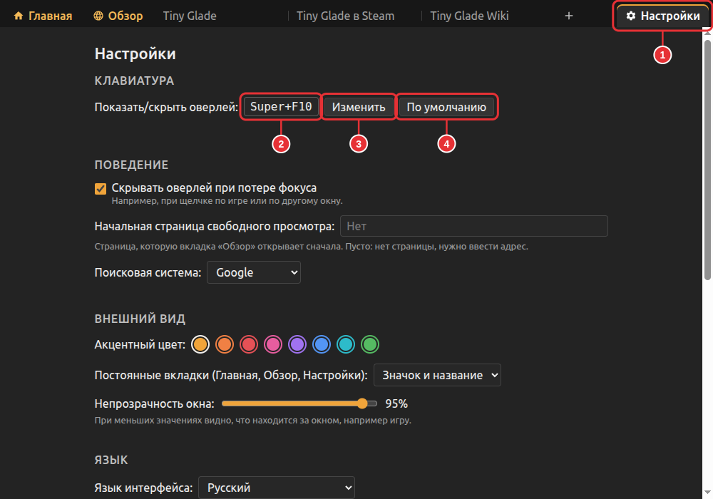
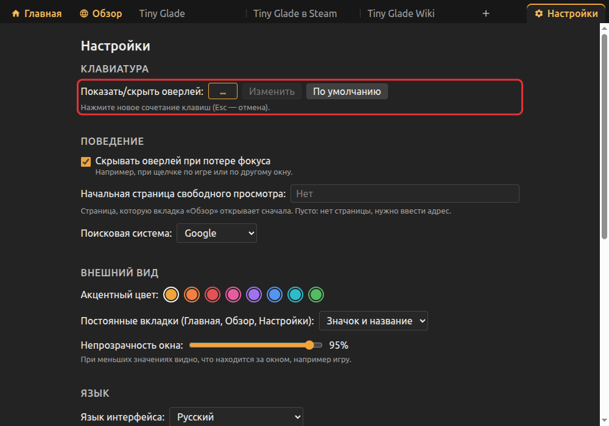
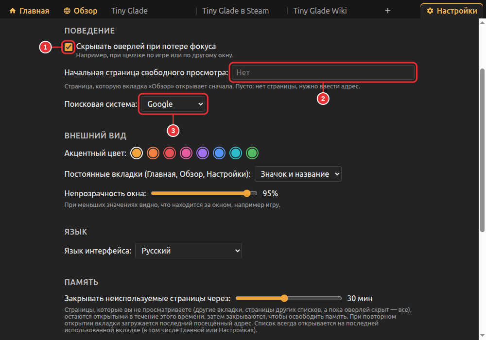
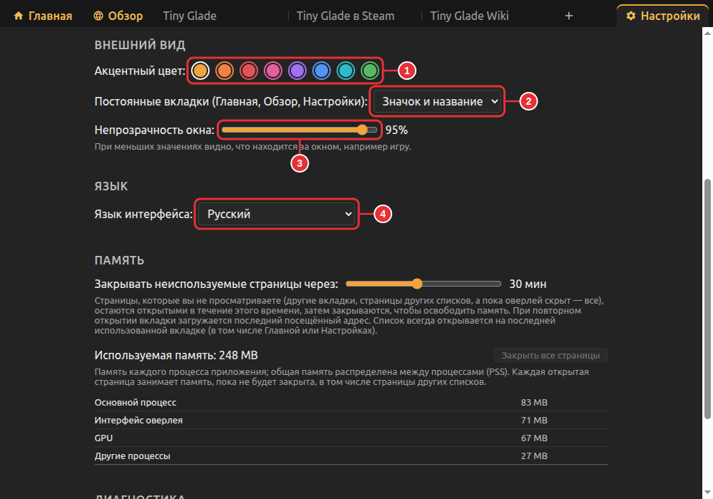
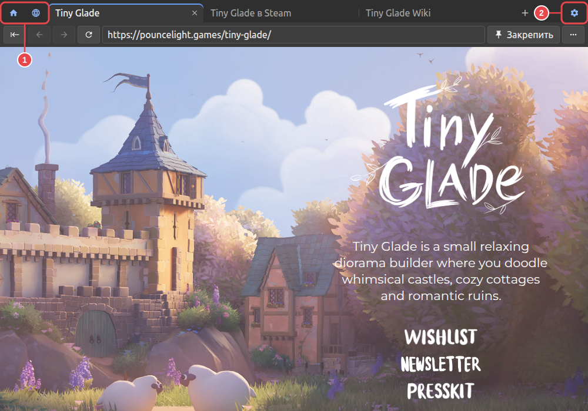

# Настройка оверлея

В разделе **Настройки** вы можете выбрать сочетание клавиш, изменить поведение, внешний вид и язык оверлея. Изменения применяются сразу и сохраняются.

На снимках экрана элементы, упомянутые в тексте, выделены красной рамкой; номера вроде ❶ в тексте указывают на элемент с тем же номером на снимке.

## 1. Сочетание клавиш

Откройте **Настройки** ❶ вверху справа или через меню значка в области уведомлений. В разделе *Клавиатура* указано **текущее сочетание** ❷ для показа и скрытия оверлея. **Изменить** ❸ записывает новое сочетание. **По умолчанию** ❹ возвращает исходное (Win+F10, Super+F10 в Linux, Cmd+Shift+Пробел в macOS).

Нажмите **Изменить**, затем нужное сочетание, например `Ctrl+Shift+O`. Для отмены нажмите Esc.

Клавиши F1–F24 можно использовать отдельно. Другие клавиши сочетайте с Ctrl, Alt, Shift или Win (Super в Linux, Cmd в macOS). Если сочетание занято другой программой, появится сообщение, а прежнее сочетание сохранится.

> **Во время игры.** Сочетание получает и сама игра. Выберите сочетание, которому в игре не назначена команда, чтобы при открытии оверлея случайно её не выполнить.

## 2. Поведение

В разделе *Поведение* доступны следующие параметры.

- **Скрывать оверлей при потере фокуса** ❶ включено по умолчанию. Оверлей скрывается, когда вы нажимаете на игру или другое окно. Отключите этот параметр, если хотите оставить оверлей видимым во время игры. Сочетание клавиш по-прежнему позволяет скрыть оверлей. Этот параметр есть и в меню значка в области уведомлений.
- **Начальная страница свободного просмотра** ❷ определяет, какую страницу вкладка «Обзор» открывает первой. Если оставить поле пустым, страница не откроется. См. [Свободный просмотр](free-browsing.md).
- **Поисковая система** ❸ определяет, где искать текст, введённый во вкладке «Обзор». Доступны Google, Bing, DuckDuckGo, Brave Search, Ecosia, Startpage и вариант *Другая*. В собственном адресе поиска укажите `%s` вместо текста запроса.

Параметр *Проверять новые версии* выводит уведомление на главной, когда выходит новая версия. Версия из Microsoft Store обновляется через магазин.

## 3. Внешний вид и язык

В разделе *Внешний вид* доступны следующие параметры.

- **Акцентный цвет** ❶ меняет цвет постоянных вкладок, основных кнопок и других элементов.
- **Постоянные вкладки** ❷ показывает значок и название вкладок «Главная», «Обзор» и «Настройки». Вариант *Только значок* оставляет больше места вкладкам сайтов.
- **Непрозрачность окна** ❸ можно менять от 30% до 100%. При меньшем значении через окно видно игру.

В разделе *Язык* параметр **Язык интерфейса** ❹ по умолчанию использует *Язык системы*, если приложение его поддерживает (итальянский, английский, французский, португальский, русский, испанский и немецкий). В остальных случаях используется английский.

Здесь у оверлея синий акцентный цвет, а у **постоянных вкладок только значки** ❶ ❷. Снимок показывает само окно, поэтому игру за ним и эффект прозрачности здесь не видно.

## Другие разделы

Ниже раздел *Память* показывает, сколько памяти использует приложение и когда закрываются неиспользуемые страницы. Раздел *Диагностика* помогает собрать сведения для сообщения о проблеме.
