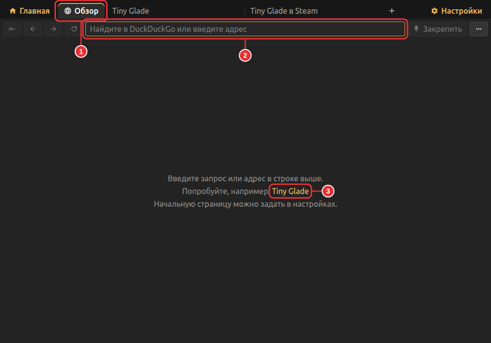
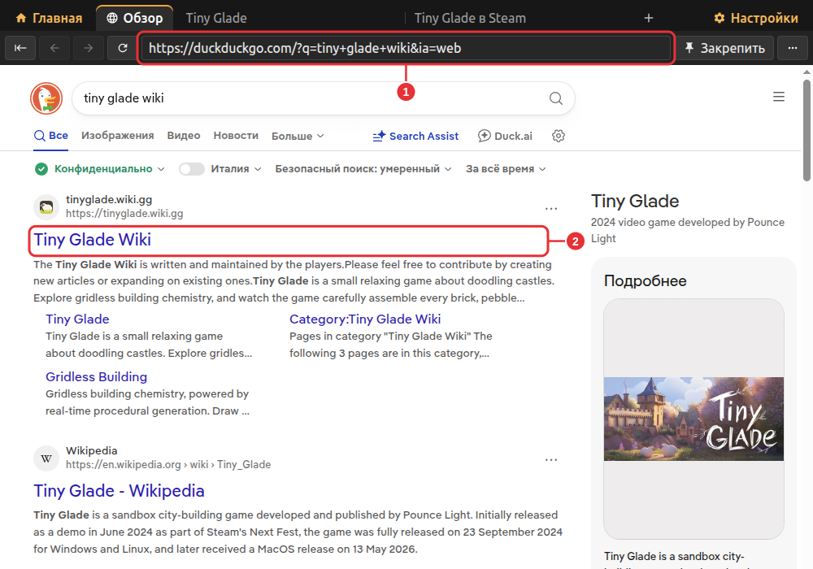
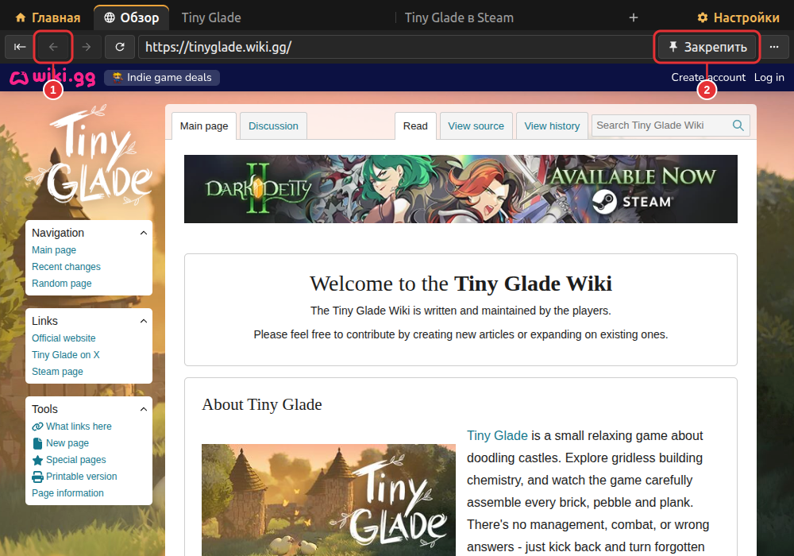
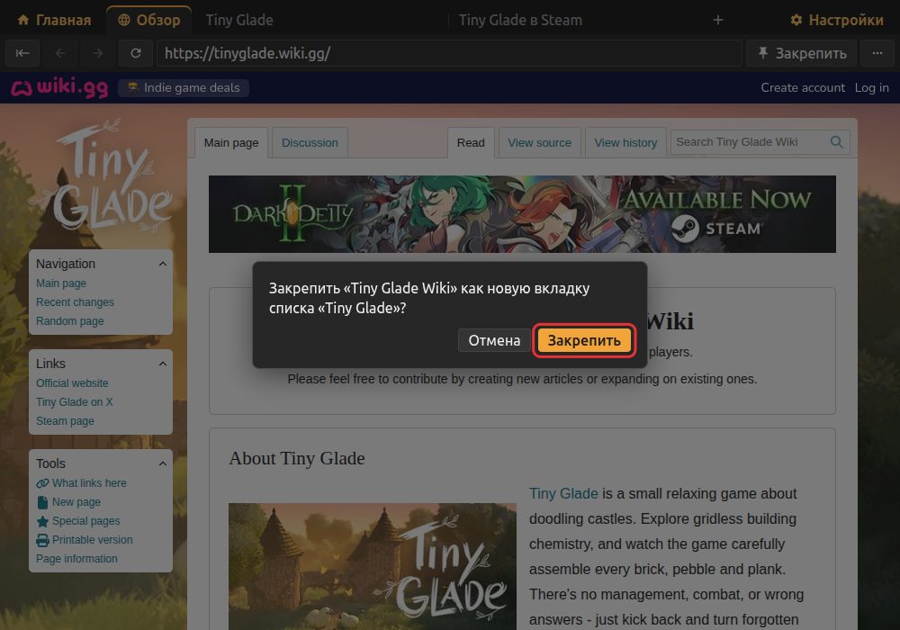
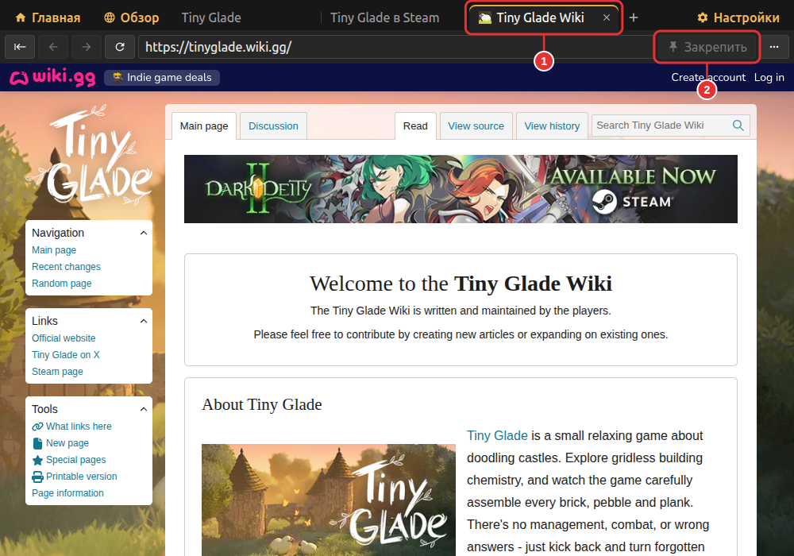
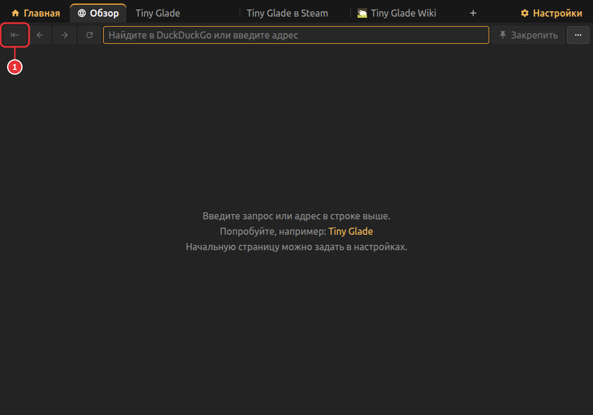

# Свободный просмотр: поиск и закрепление страниц

Во вкладке **Обзор** можно искать и открывать любые страницы без добавления в список. Если хотите сохранить страницу, кнопка **Закрепить** сделает её вкладкой в списке игры.

Продолжим пример из руководства [Первые шаги](getting-started.md). Оверлей открыт поверх **Tiny Glade**, в списке уже есть два сайта, и теперь мы ищем вики игры.

На снимках экрана элементы, упомянутые в тексте, выделены красной рамкой; номера вроде ❶ в тексте указывают на элемент с тем же номером на снимке.

## 1. Откройте вкладку «Обзор»

Нажмите **Обзор** ❶ рядом с главной страницей. В **поле адреса** ❷ введите адрес (достаточно `example.com`) или поисковый запрос. Оверлей предлагает в качестве примера **название игры** ❸. Нажмите на него, чтобы запустить поиск.

## 2. Найдите страницу

Введите `tiny glade wiki` и нажмите Enter. Результаты откроются во вкладке, а **поле адреса** ❶ покажет адрес страницы результатов.

Поисковую систему можно выбрать в настройках, в разделе *Поведение*. Доступны Google, Bing, DuckDuckGo, Brave Search, Ecosia, Startpage и собственный адрес. Здесь мы используем DuckDuckGo.

Нажмите на нужный результат, в нашем примере **Tiny Glade Wiki** ❷.

## 3. Закрепите страницу

Страница откроется во вкладке «Обзор» и будет работать как в браузере. Кнопка **Назад** ❶ вернёт вас к результатам поиска. Чтобы сохранить страницу, нажмите **Закрепить** ❷.

Оверлей попросит подтверждение. Нажмите **Закрепить**.

## 4. Страница стала вкладкой списка

Страница вместе с историей станет **новой вкладкой** ❶ в конце списка Tiny Glade. Вы найдёте её там при каждом открытии оверлея поверх игры. Кнопка **Закрепить** ❷ недоступна, потому что страница уже в списке.

Закреплять страницы можно и во вкладках сайтов. Новая вкладка появится сразу после исходной. Если страница уже есть в списке, её вкладка подсвечивается, а кнопка «Закрепить» недоступна.

## 5. Вкладка «Обзор» снова свободна

Вернувшись в **Обзор**, вы увидите пустую вкладку, готовую к новому поиску. Закреплённая страница переместилась в свою вкладку. Во время просмотра кнопка **Вернуться на начальную страницу** ❶ закрывает открытую страницу и возвращает пустой экран.

В настройках, в разделе *Поведение*, можно задать параметр **Начальная страница свободного просмотра**. Она будет открываться вместо пустого экрана.

## Адреса других сайтов во вкладках сайтов

Во вкладках сайтов тоже можно вводить адреса. Страница того же сайта откроется в текущей вкладке. Адрес другого сайта или поисковый запрос откроется во вкладке «Обзор» после подтверждения. Исходная вкладка сохранит свою страницу.
