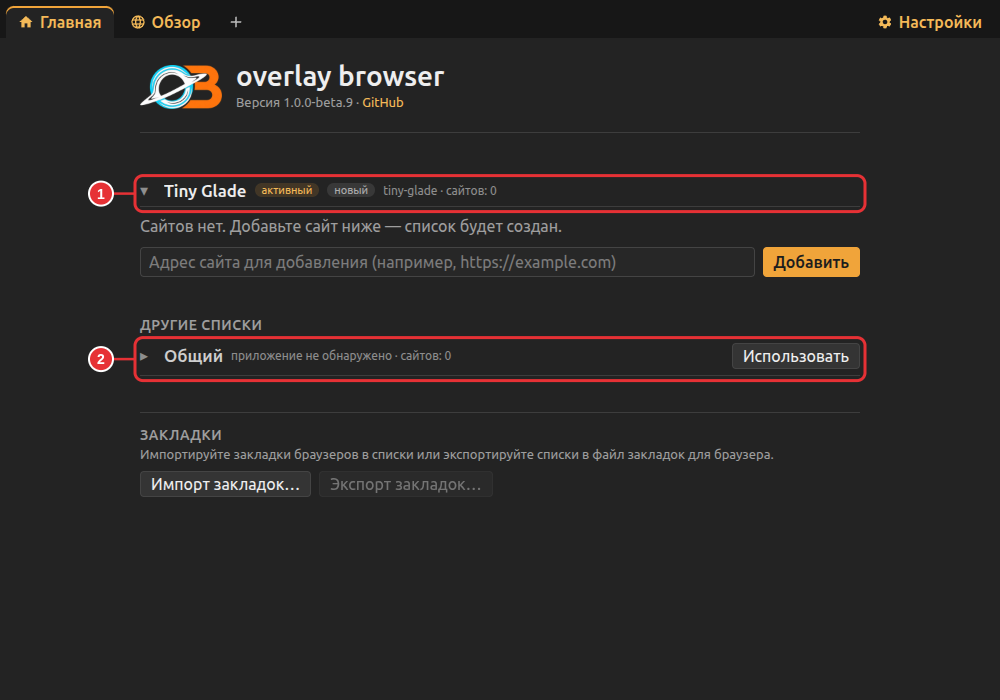
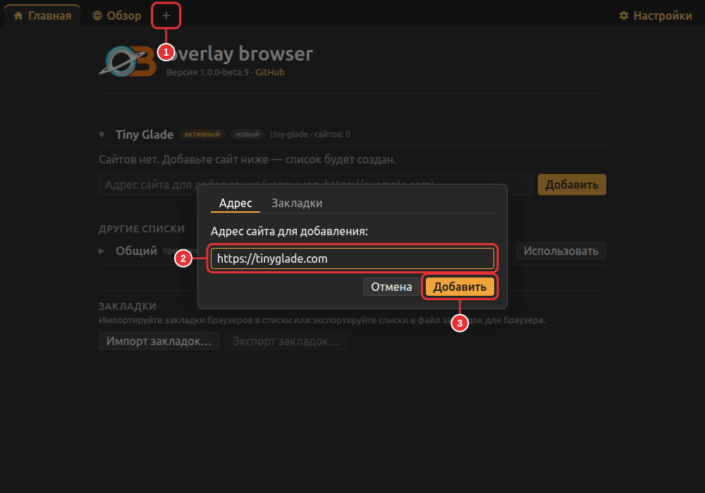
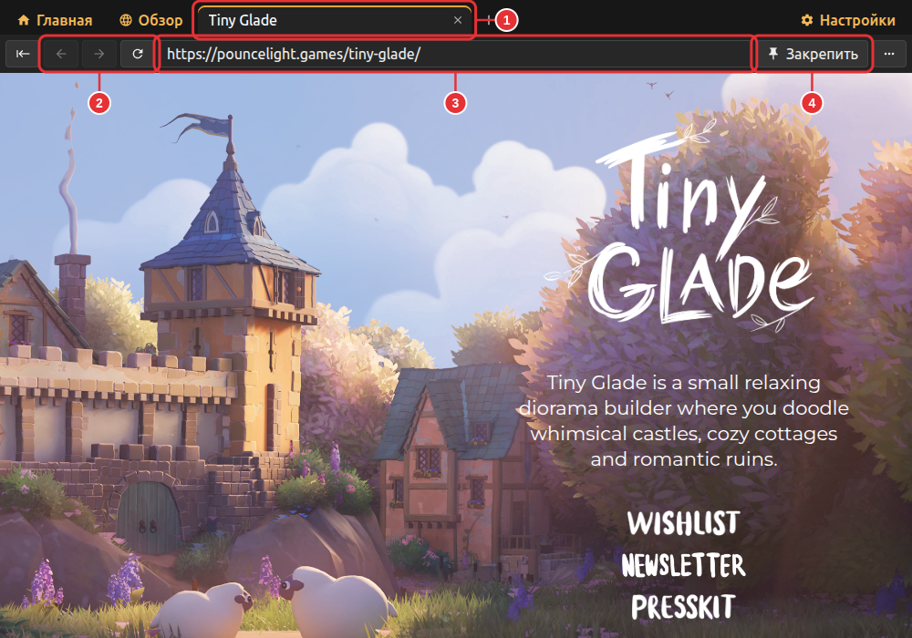
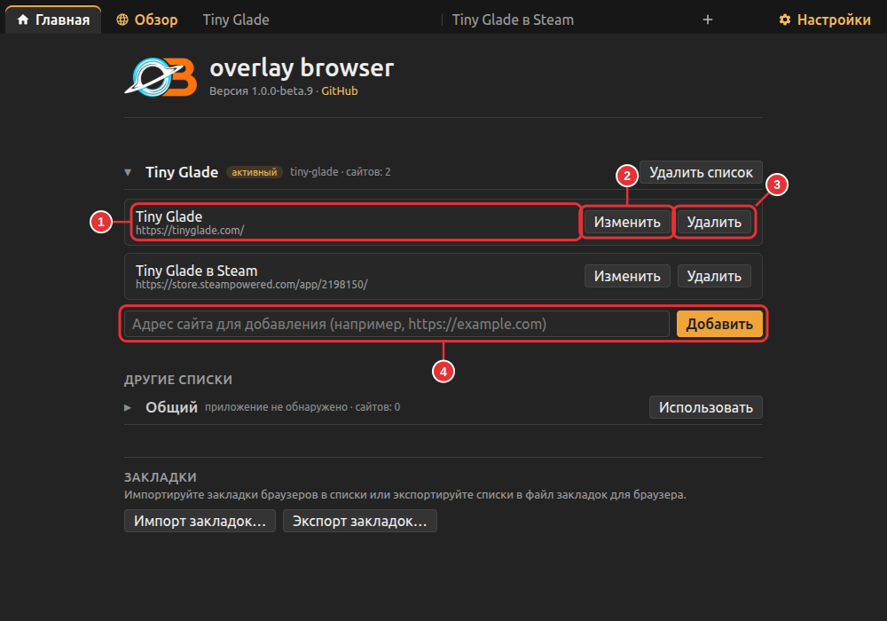
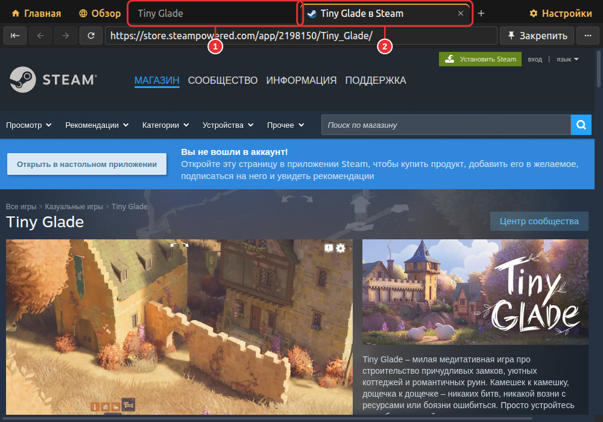

# Первые шаги: сайты вашей игры под рукой

В этом руководстве вы откроете Overlay Browser во время игры в **Tiny Glade**, добавите пару полезных сайтов и научитесь показывать и скрывать их, не выходя из игры.

На снимках экрана элементы, упомянутые в тексте, выделены красной рамкой; номера вроде ❶ в тексте указывают на элемент с тем же номером на снимке.

## 1. Запустите приложение

Запустите Overlay Browser. Окно **останется скрытым**, а значок приложения появится в области уведомлений рядом с часами. На панели задач и в списке Alt+Tab приложения нет.

Затем запустите игру в оконном режиме или в режиме окна без рамки.

## 2. Откройте оверлей поверх игры

Во время игры нажмите **Win+F10** (Super+F10 в Linux, Cmd+Shift+Пробел в macOS). Оверлей откроется поверх игры на вкладке **Главная**.

Оверлей распознал игру. Вверху показан список **Tiny Glade** ❶. Он *активный* и пока *новый*. У каждой игры свой список сайтов. Он создаётся, когда вы добавляете первый сайт. В разделе *Другие списки* есть список **Общий** ❷. Он активен, когда игра не открыта. Чтобы выбрать его вручную, нажмите **Использовать**.

## 3. Добавьте сайт

Нажмите **+** ❶ на верхней панели, введите **адрес** сайта ❷ (достаточно `tinyglade.com`) и нажмите **Добавить** ❸.

Сайт сразу откроется в своей **вкладке** ❶ с заголовком страницы. Нажмите **×**, чтобы закрыть вкладку. Ниже расположена панель навигации, как в браузере. Кнопки **Назад**, **Вперёд** и **Обновить** ❷ управляют страницей. В поле **адреса** ❸ можно ввести другой адрес и нажать Enter. Кнопка **Закрепить** ❹ превращает найденную страницу в новую вкладку.

## 4. Добавьте ещё сайты с главной страницы

Откройте вкладку **Главная**, чтобы увидеть сайты списка. Нажмите **название сайта** ❶, чтобы открыть его, **Изменить** ❷, чтобы поменять адрес (Enter сохраняет, Esc отменяет), или **Удалить** ❸, чтобы убрать сайт из списка. Для добавления введите адрес в **поле под списком** ❹ и нажмите *Добавить*. В примере мы добавили страницу игры в Steam.

## 5. Переключайтесь между сайтами

У каждого сайта своя вкладка. Здесь видны **официальный сайт** ❶ и **страница Steam** ❷, которая сейчас открыта. Вернувшись к вкладке, вы найдёте страницу там, где её оставили.

## 6. Вернитесь к игре

Снова нажмите **Win+F10**, чтобы скрыть оверлей, или щёлкните по окну игры. По умолчанию оверлей скрывается при потере фокуса. Это можно отключить в настройках.

Когда вы снова откроете оверлей поверх Tiny Glade, его список откроется на последней использованной вкладке. Поверх другой игры появится список этой игры.
