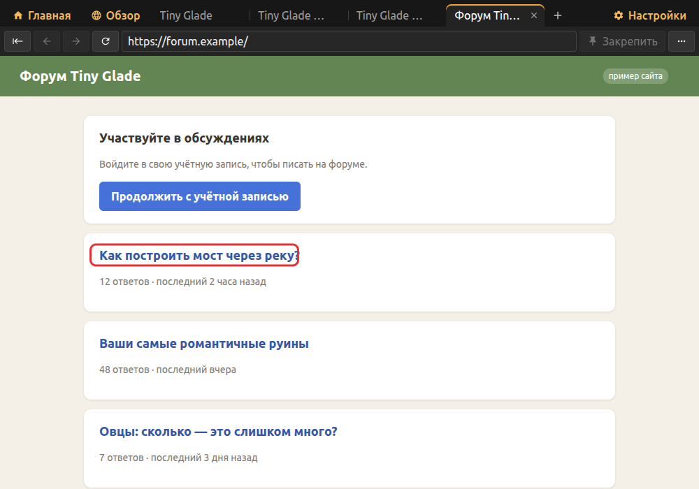
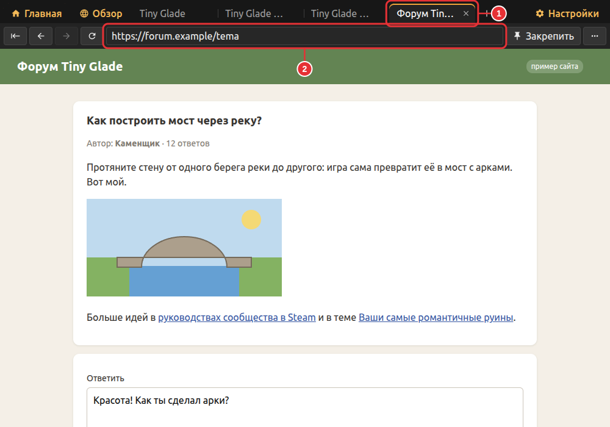
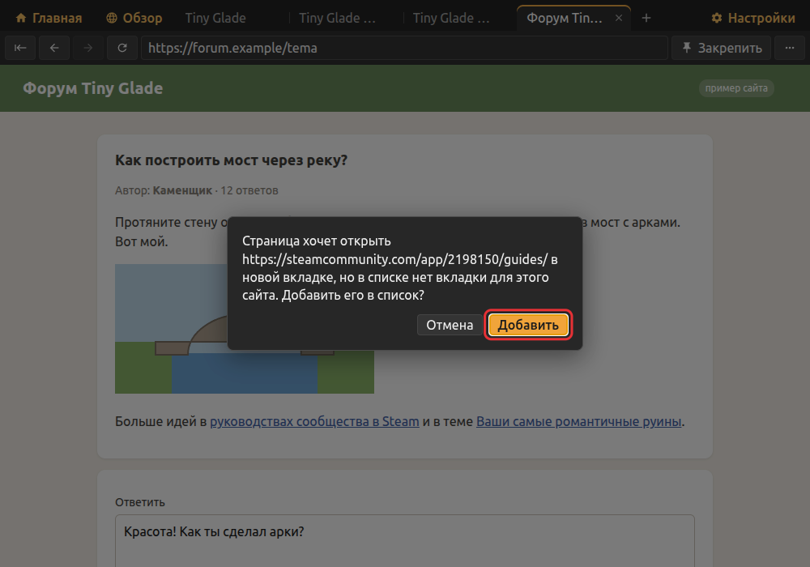
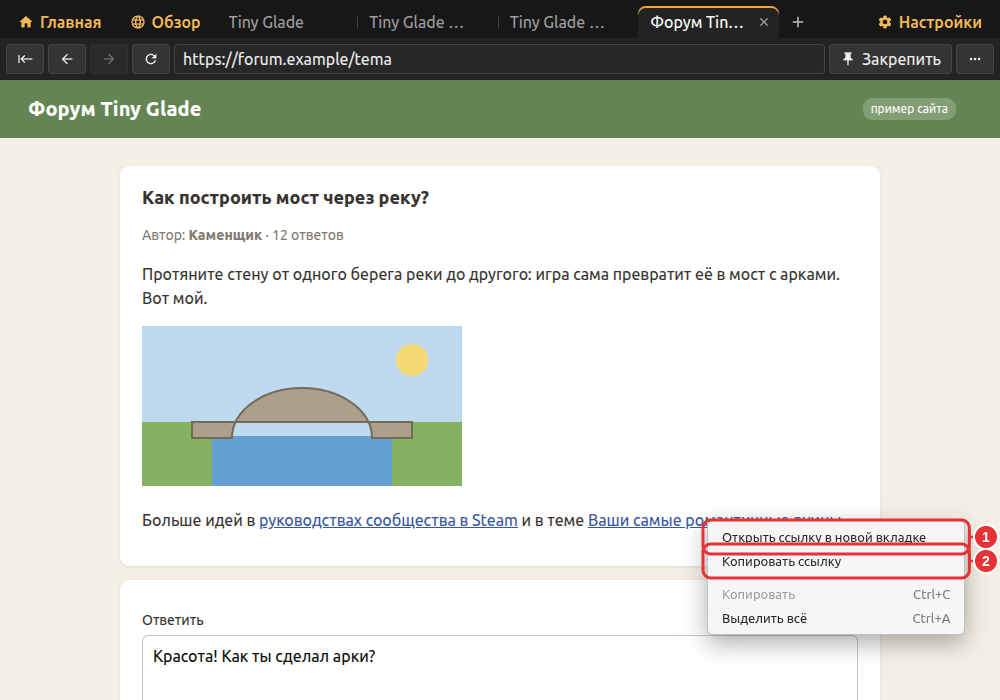
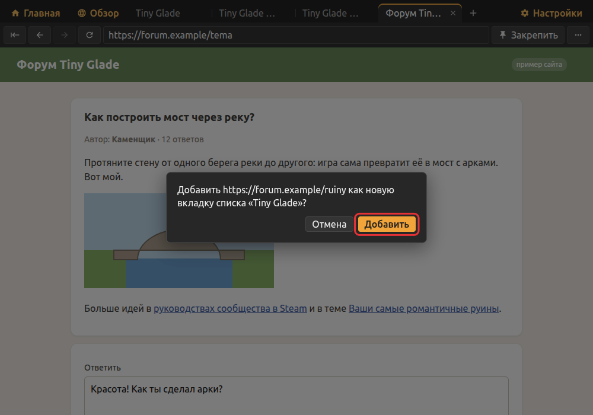
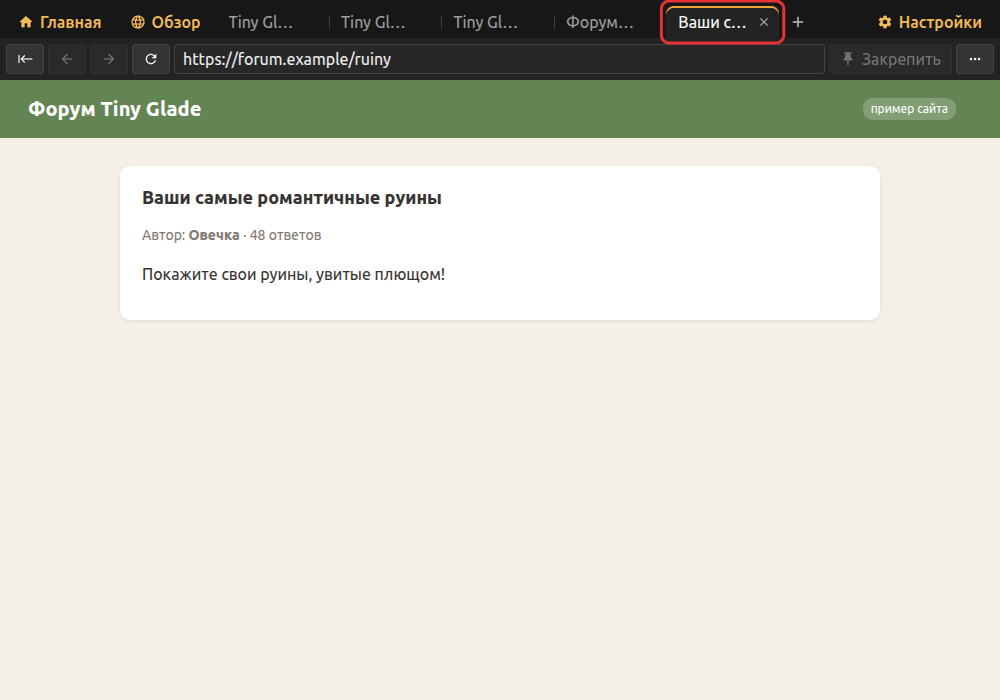
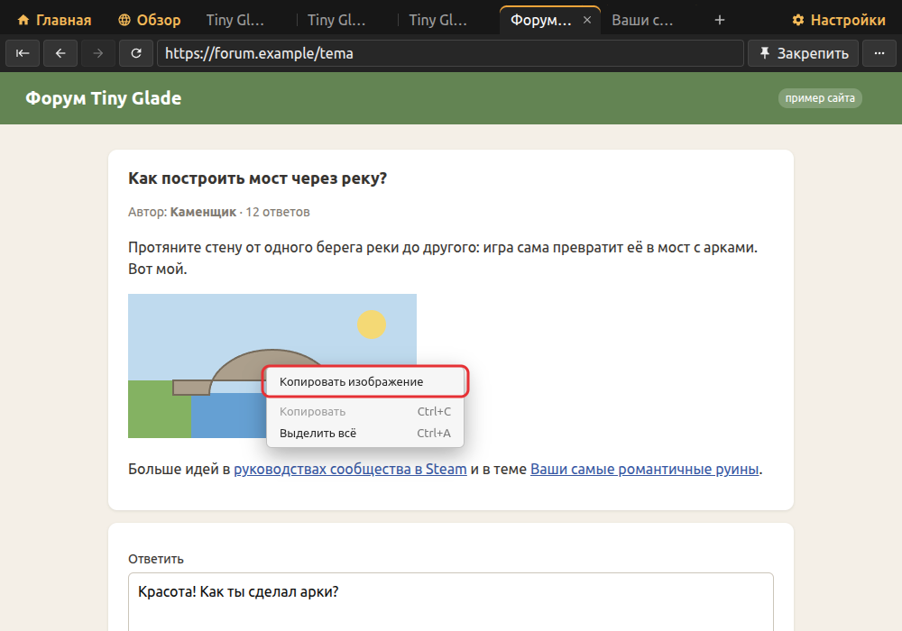
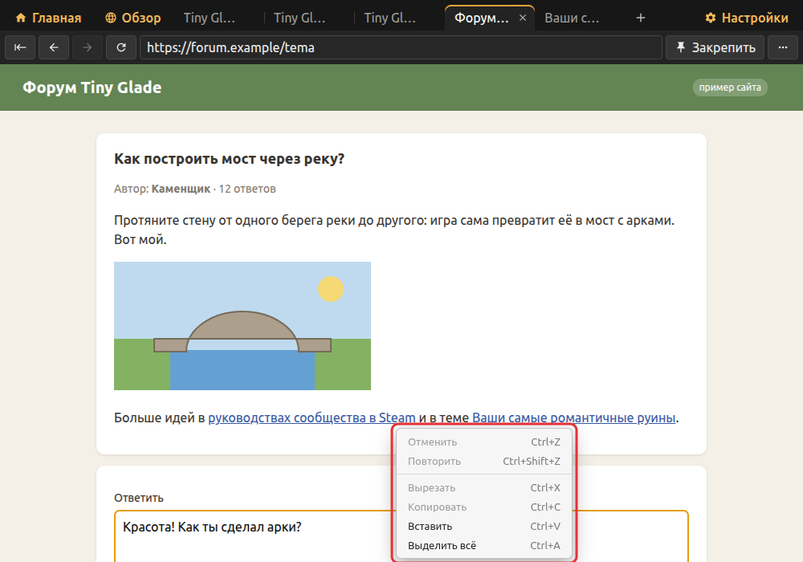

# Ссылки, новые вкладки и контекстное меню

В браузере многие ссылки открываются в новых вкладках. В оверлее вкладки соответствуют сайтам из списка. Такие ссылки открываются во вкладке исходного сайта или после подтверждения в новой. Щелчок правой кнопкой мыши открывает меню, через которое можно открыть ссылку в новой вкладке и скопировать ссылку, изображение или текст.

В списке **Tiny Glade** есть форум, **пример сайта** для этого руководства. См. [Вход на сайт и удаление cookie](signing-in.md).

На снимках экрана элементы, упомянутые в тексте, выделены красной рамкой; номера вроде ❶ в тексте указывают на элемент с тем же номером на снимке.

## 1. Ссылка, которая открывается в новой вкладке

Некоторые ссылки предназначены для открытия в новой вкладке, например ссылка на эту тему форума. То же происходит при щелчке с Ctrl или средней кнопкой мыши.

## 2. Тот же сайт открывается в своей вкладке

Если ссылка ведёт на тот же сайт, новая страница открывается во **вкладке сайта** ❶ и заменяет предыдущую. В поле **адреса** ❷ теперь указан адрес темы. Кнопка **Назад** вернёт прежнюю страницу.

Если в списке несколько вкладок одного сайта, ссылка открывается в той, где вы на неё нажали.

## 3. Для другого сайта требуется подтверждение

Если ссылка ведёт на сайт, у которого нет вкладки в списке, как в примере с руководствами сообщества Steam, оверлей предложит добавить сайт. Кнопка **Добавить** добавит его в список и откроет. Кнопка **Отмена** оставит текущую страницу открытой.

Ссылки из вкладки **Обзор** открываются в этой же вкладке. См. [Свободный просмотр](free-browsing.md).

## 4. Щёлкните правой кнопкой по ссылке

При таком щелчке в меню появляются **Открыть ссылку в новой вкладке** ❶ и **Копировать ссылку** ❷. Второй пункт копирует адрес ссылки.

Пункт **Открыть ссылку в новой вкладке** запрашивает подтверждение перед добавлением ссылки в список. Нажмите **Добавить**.

Ссылка открывается в **новой вкладке** сразу после исходной. Если в списке уже есть вкладка с этим адресом, оверлей переключится на неё.

## 5. Щёлкните правой кнопкой по изображению или тексту

Для изображения есть пункт **Копировать изображение**, чтобы затем вставить его, например, в чат. Для текста страницы доступны **Копировать** (если текст выделен) и **Выделить всё**.

В текстовых полях, например в поле ответа на форуме или в адресной строке, есть **Отменить**, **Повторить**, **Вырезать**, **Копировать**, **Вставить** и **Выделить всё**. Недоступные действия отображаются серым, например *Копировать*, если текст не выделен.

