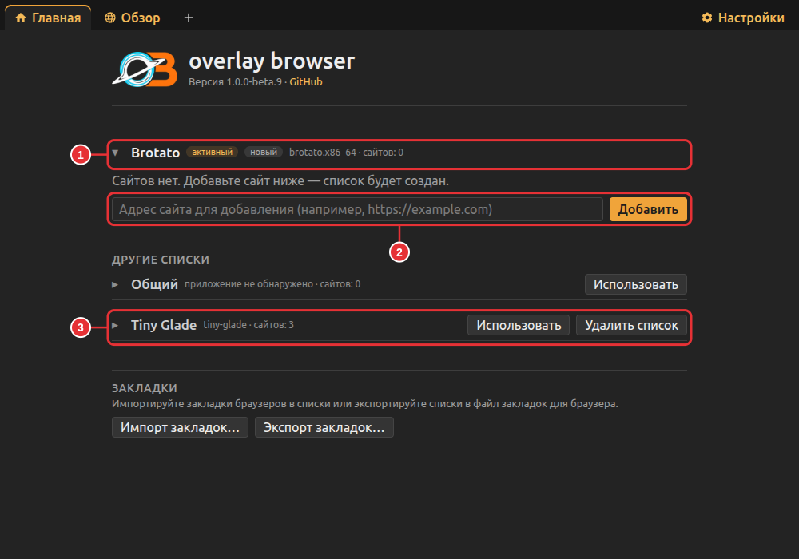
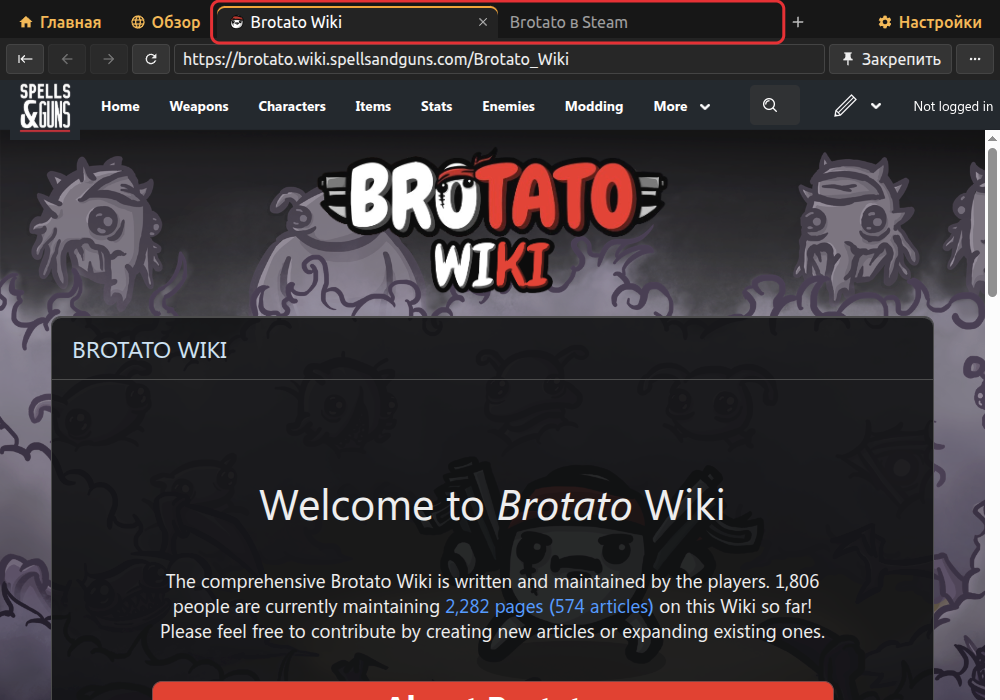
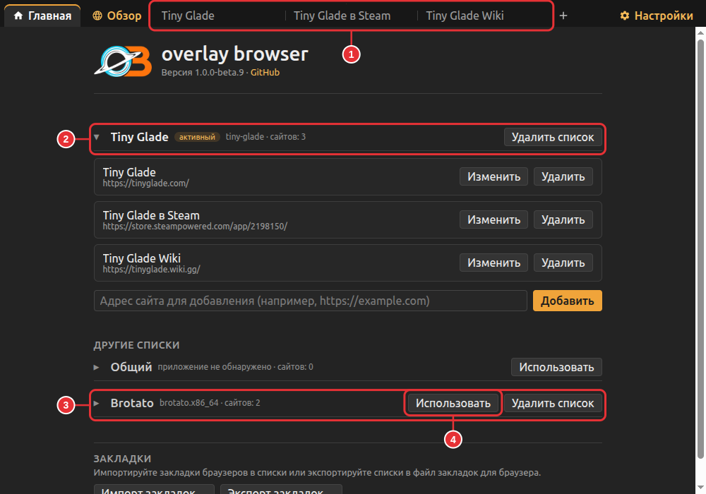
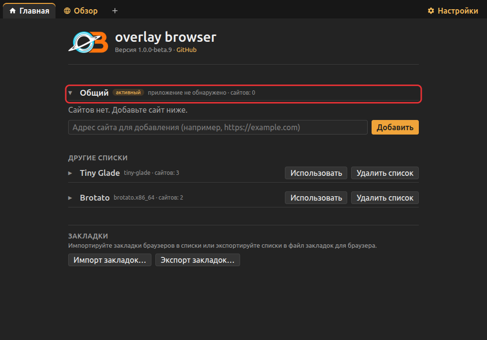
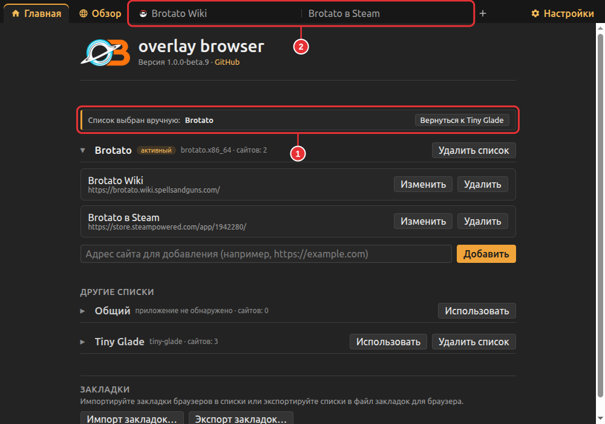
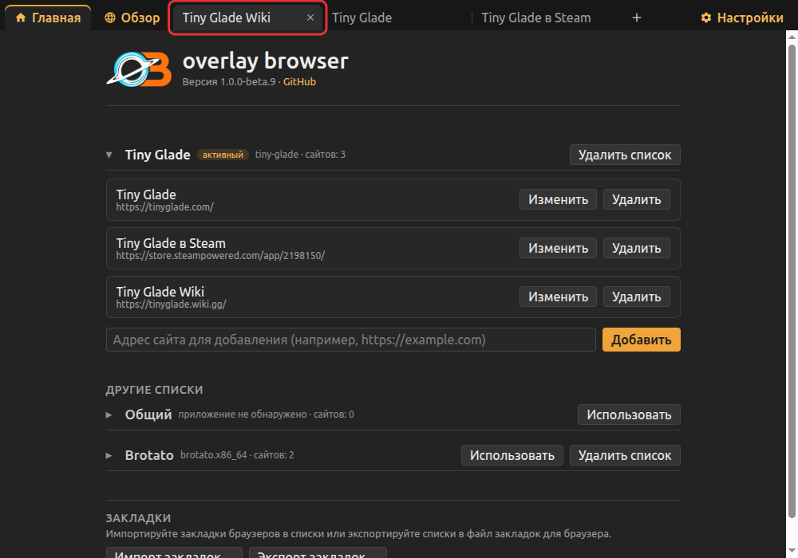
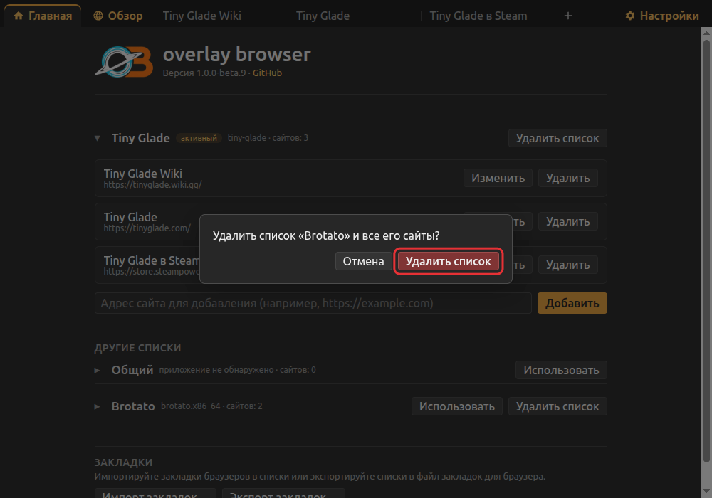

# У каждой игры свой список

Overlay Browser распознаёт игру, поверх которой вы его открыли, и показывает её сайты. У каждой игры свой **список**. После [первых шагов](getting-started.md) и [свободного просмотра](free-browsing.md) в списке **Tiny Glade** уже три сайта. Теперь запустим **Brotato**.

На снимках экрана элементы, упомянутые в тексте, выделены красной рамкой; номера вроде ❶ в тексте указывают на элемент с тем же номером на снимке.

## 1. Новая игра, новый список

Откройте оверлей во время игры в Brotato. Вверху главной страницы находится **список Brotato** ❶. Он *активный* и пока *новый*. Рядом с названием указаны распознанная программа и число сайтов. Добавьте сайт через **поле под списком** ❷ или через **+** на верхней панели. Список создастся вместе с первым сайтом. **Список Tiny Glade** ❸ свёрнут в разделе *Другие списки*. Нажмите на него, чтобы увидеть сайты.

Добавим вики Brotato и страницу игры в Steam. Теперь на панели видны только вкладки Brotato.

## 2. У каждой игры свои сайты

Вернитесь в Tiny Glade и откройте оверлей. На панели видны **вкладки Tiny Glade** ❶, а **список Tiny Glade** ❷ активен. **Список Brotato** ❸ переместился в раздел *Другие списки*. Кнопка **Использовать** ❹ позволяет выбрать его вручную (см. шаг 4). Каждый список открывается на той вкладке, которой вы пользовались в последний раз.

## 3. Общий список

Оверлей предлагает список для любой программы, поверх которой вы его открываете. Если программа не распознана, активен **список Общий**. В нём удобно держать сайты, которые не относятся к конкретной программе. Он работает так же, как другие списки, и его нельзя удалить.

## 4. Выберите список вручную

Иногда нужны сайты другой игры, например вики Brotato, пока открыта Tiny Glade. Нажмите **Использовать** рядом с нужным списком (❹ на снимке к шагу 2).

Появится надпись **Список выбран вручную** ❶. Выбранный список остаётся активным, даже если вы откроете оверлей поверх другой игры. Нажмите **Вернуться к Tiny Glade**, чтобы вернуться к списку игры, поверх которой сейчас открыт оверлей. На панели видны **вкладки выбранного списка** ❷.

## 5. Измените порядок вкладок и сайтов

Перетащите вкладку в нужное место на панели. В примере Tiny Glade Wiki перемещается на первое место.

Так же можно перетаскивать сайты на главной странице. Порядок сайтов и вкладок совпадает.

## 6. Удалите список

Кнопка **Удалить список** рядом с названием удаляет список со всеми сайтами после подтверждения.

Если вы снова добавите сайт во время игры в Brotato, список будет создан заново.
