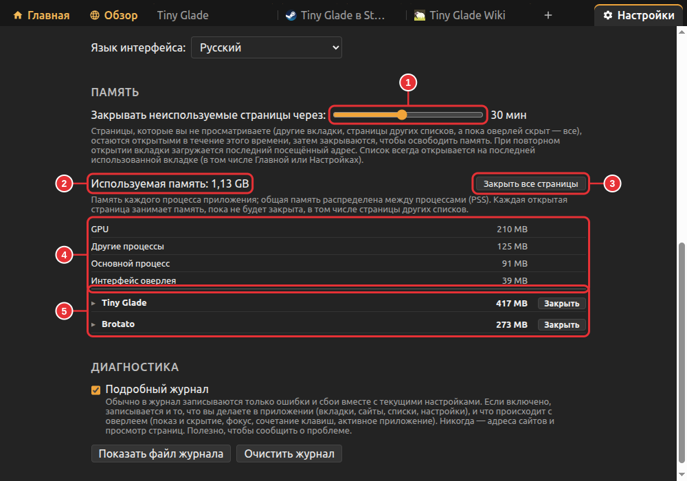
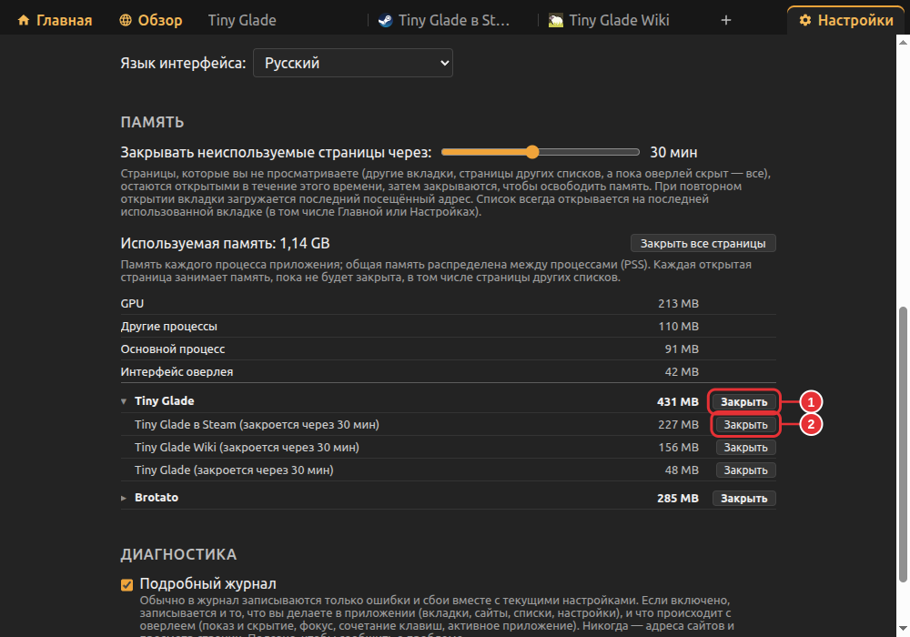
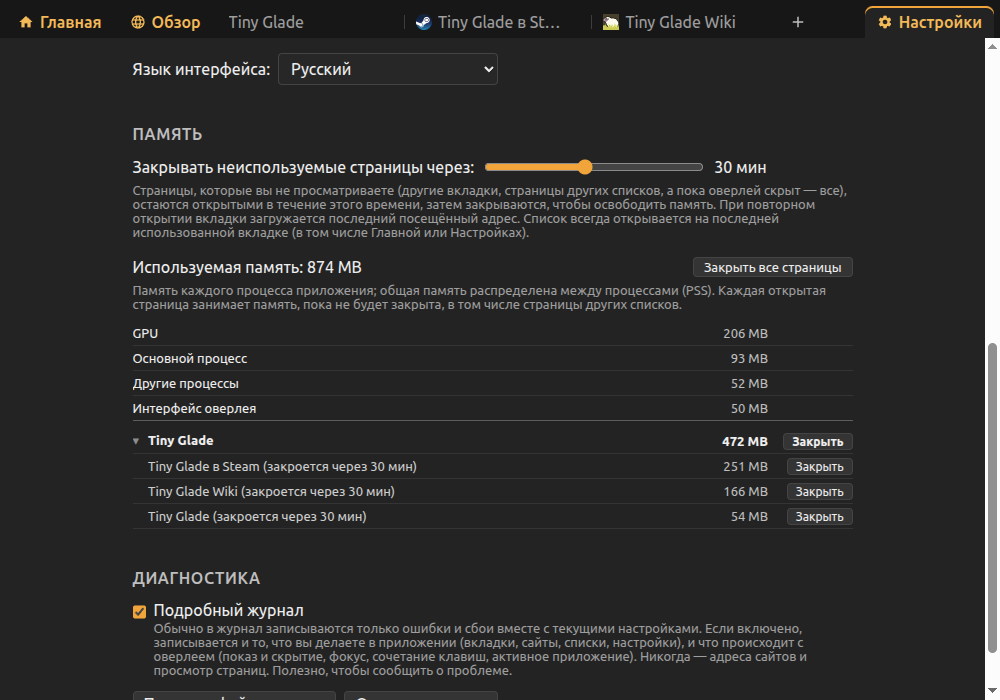

# Память и закрытие страниц

Как и в браузере, каждая открытая страница Overlay Browser использует память, даже если вы на неё не смотрите. Это касается и открытых страниц из других списков. Чтобы освободить память для игры, оверлей **сам закрывает страницы, которыми вы давно не пользовались**. В настройках можно посмотреть расход памяти и закрыть страницы вручную.

В примере в списках **Tiny Glade** и **Brotato** открыто несколько страниц. См. [У каждой игры свой список](lists-per-game.md).

На снимках экрана элементы, упомянутые в тексте, выделены красной рамкой; номера вроде ❶ в тексте указывают на элемент с тем же номером на снимке.

## 1. Почему страница загружается заново

Страницы, которые вы не просматриваете, остаются открытыми некоторое время, а затем закрываются. Это относится к другим вкладкам, страницам из других списков и ко всем страницам, пока оверлей скрыт. Когда вы снова откроете вкладку, страница **загрузится по последнему посещённому адресу**. Вы вернётесь на страницу, но положение прокрутки или частично заполненная форма могут потеряться.

Страница, которую вы просматриваете, остаётся открытой.

## 2. Раздел «Память»

Откройте **Настройки** и прокрутите до раздела *Память*.

- **Закрывать неиспользуемые страницы через** ❶ задаёт время ожидания от 5 до 60 минут. По умолчанию это 30 минут. Если свободной памяти мало или игра требовательная, выберите меньшее время.
- **Используемая память** ❷ показывает расход памяти всего приложения.
- **Закрыть все страницы** ❸ сразу закрывает открытые страницы во всех списках.
- **Процессы приложения** ❹ включают интерфейс оверлея, основной процесс, графику (GPU) и другие процессы. Они всегда занимают память.
- **Страницы по спискам** ❺ показывает память открытых страниц каждого списка. Кнопка **Закрыть** закрывает все страницы этого списка.

## 3. Страницы одного списка

Нажмите название списка, чтобы увидеть открытые страницы, расход памяти каждой из них и время до закрытия. Кнопка **Закрыть** рядом со списком ❶ закрывает все его страницы. Кнопка **Закрыть** рядом со страницей ❷ закрывает только её.

Некоторые страницы используют один процесс, например страницы одного сайта из разных списков. Они отображаются одной строкой вне групп и закрываются вместе. Только тогда освобождается их память.

## 4. После закрытия

В примере мы закрыли страницы Brotato. Группа исчезла, а расход памяти уменьшился. Вкладки остались в списке. При следующем открытии страницы загрузятся заново.

