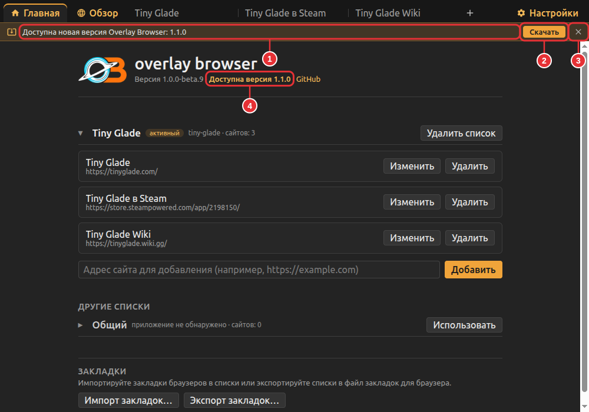
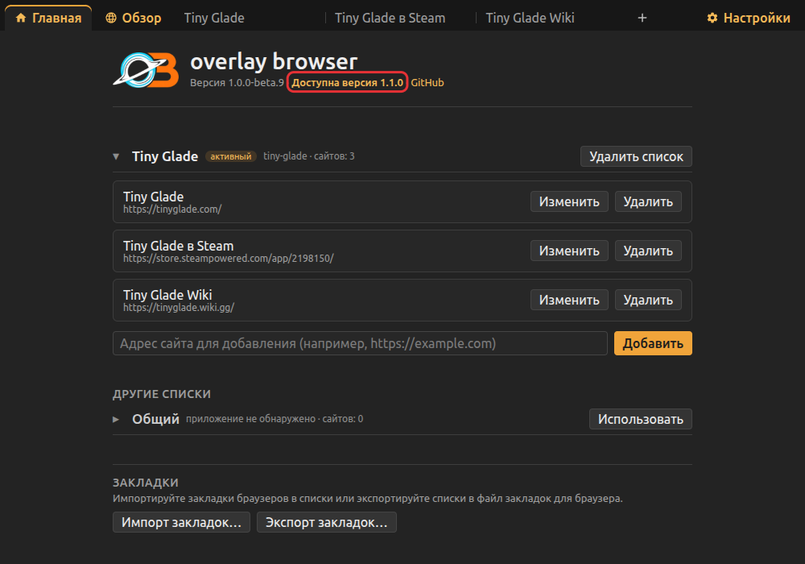
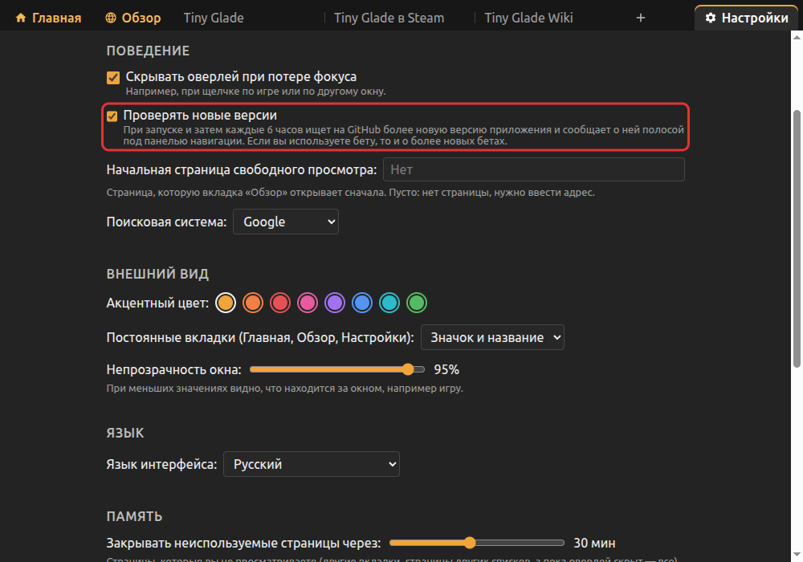

# Новые версии

Overlay Browser проверяет, вышла ли новая версия, и сообщает об этом. Когда скачать и установить её, решаете вы.

На снимках экрана элементы, упомянутые в тексте, выделены красной рамкой; номера вроде ❶ в тексте указывают на элемент с тем же номером на снимке.

## 1. Уведомление о новой версии

Когда выходит новая версия, под верхней панелью появляется **полоса уведомления** ❶ с её номером. Кнопка **Скачать** ❷ открывает в системном браузере страницу новой версии. С неё можно скачать файл для своей системы. См. раздел об установке в [README](../../README.md). Кнопка **×** ❸ закрывает полосу для этой версии.

Ссылка на новую версию также появляется вверху вкладки **Главная** ❹, рядом с номером текущей версии. Нажмите её, чтобы открыть ту же страницу.

После закрытия полосы ссылка на новую версию остаётся на главной до установки обновления.

## 2. Когда приложение проверяет обновления

Приложение проверяет выпуски проекта на GitHub вскоре после запуска, а затем каждые шесть часов. Если у вас бета-версия, оно сообщает и о новых бета-версиях. В остальных случаях уведомления приходят только о стабильных версиях.

Чтобы отключить уведомления, снимите флажок **Проверять новые версии** в разделе *Поведение* на вкладке **Настройки**. Версия из Microsoft Store получает обновления из магазина, поэтому этого параметра в ней нет.

