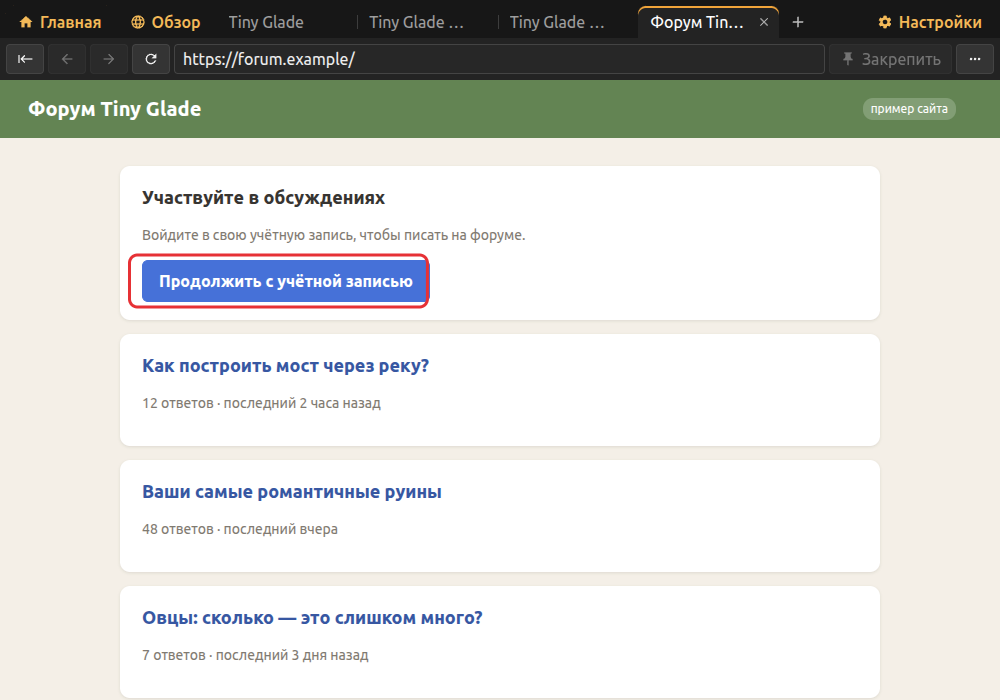
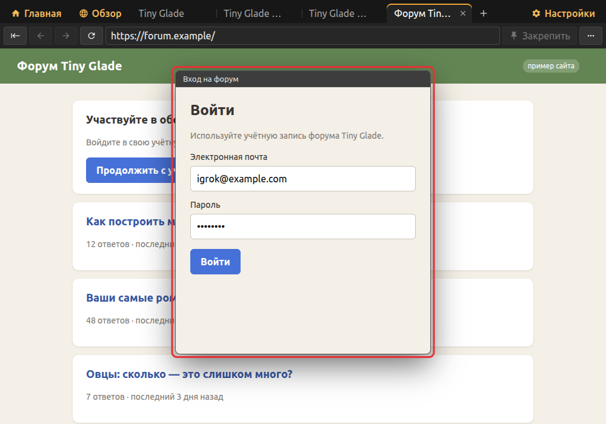
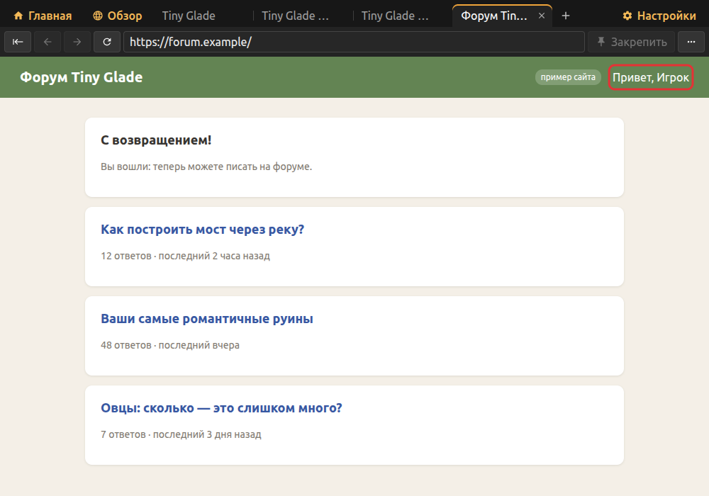
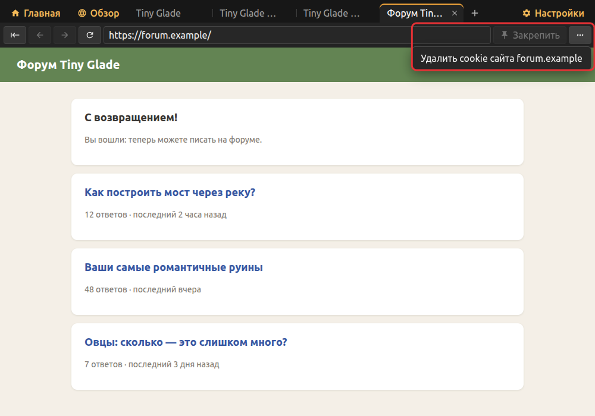
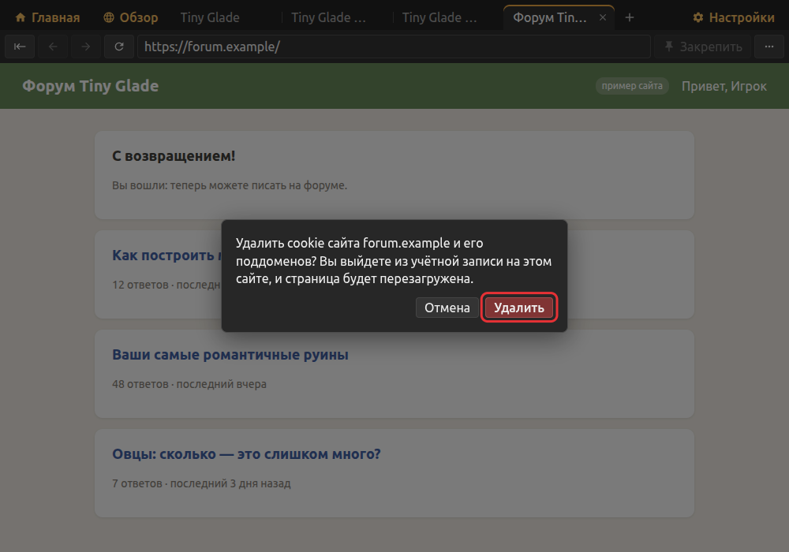

# Вход на сайт и удаление cookie

Многие игровые сайты, например форумы, вики и инструменты для создания билдов, предоставляют больше возможностей после входа или требуют учётную запись. В оверлее вы входите как в обычном браузере, и вход сохраняется. Если сайт перестал нормально работать или вы хотите выйти из учётной записи, можно удалить его cookie.

В списке **Tiny Glade** есть форум. Этот **пример сайта** создан для руководства. Вход работает так же, как на реальных сайтах, например через *Войти через Google*.

На снимках экрана элементы, упомянутые в тексте, выделены красной рамкой; номера вроде ❶ в тексте указывают на элемент с тем же номером на снимке.

## 1. Войдите в учётную запись

Откройте вкладку сайта и нажмите кнопку входа. В примере это **Продолжить с учётной записью**.

Сайт откроет **окно входа** поверх оверлея. Введите данные и подтвердите вход.

Окно входа является частью оверлея. Оно остаётся поверх него, скрывается и появляется вместе с ним. Можно переходить между окнами, и они останутся видимыми. Когда окно входа закроется, фокус вернётся оверлею.

## 2. Вход сохраняется

После входа окно закрывается, и сайт показывает вашу **учётную запись**.

Вход сохраняется при закрытии оверлея и перезапуске приложения. Если один и тот же сайт есть в нескольких списках, вход действует во всех этих списках.

## 3. Удалите cookie сайта

Cookie — это данные, которые сайт хранит, чтобы узнавать вас и запоминать вход. Их можно удалить, чтобы **выйти из учётной записи**, например перед входом в другую, или если **сайт перестал нормально работать**.

Во вкладке сайта нажмите **…** (*Другие действия*) справа от адреса и выберите **Удалить cookie сайта forum.example**.

Когда оверлей попросит подтверждение, нажмите **Удалить**. Cookie сайта и его поддоменов будут удалены. Cookie других сайтов сохранятся.

## 4. Страница загружается заново

После удаления cookie страница перезагрузится. Вы вышли из учётной записи, и сайт снова предложит **войти**.

