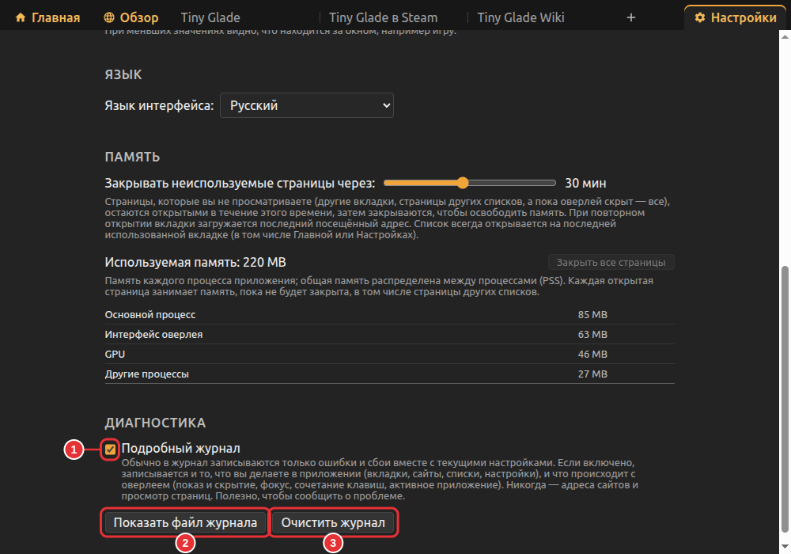
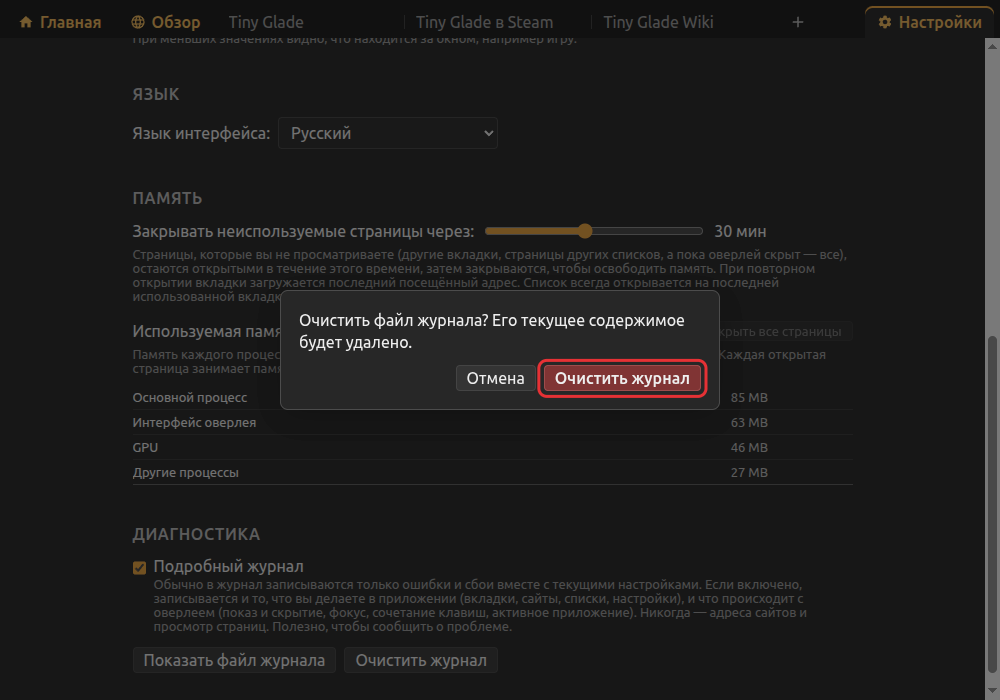

# Устранение неполадок

Здесь описано, как решать частые проблемы и собирать сведения для сообщения об ошибке. Подробности для Windows, Linux и macOS приведены в [README](../../README.md).

На снимках экрана элементы, упомянутые в тексте, выделены красной рамкой; номера вроде ❶ в тексте указывают на элемент с тем же номером на снимке.

## 1. Сочетание клавиш не работает

- **Его уже использует другая программа.** Если выбрать его в настройках, оверлей сообщит, что сочетание «недопустимое или оно уже занято», и сохранит предыдущее. Выберите другое. См. [Настройка оверлея](customizing.md).
- **Игра использует его для своей команды.** Сочетание клавиш получает и игра. Выберите сочетание, которое ничего в ней не запускает.
- **Linux с Wayland.** Сочетание не распознаётся, пока активно нативное окно Wayland. Используйте сеанс X11. См. раздел *Linux* в [README](../../README.md#linux).
- **Функциональные клавиши в macOS.** По умолчанию F1–F12 управляют яркостью, громкостью и другими параметрами. Нажимайте их вместе с **fn** или измените настройки клавиатуры. См. раздел *macOS* в [README](../../README.md#macos).

Оверлей можно открыть и через значок в области уведомлений.

## 2. Не видно значка приложения

Приложение находится в области уведомлений рядом с часами. Оно не появляется на панели задач или в списке Alt+Tab.

- **Windows.** Если значок скрыт, нажмите стрелку **^** и перетащите значок на панель задач, чтобы он всегда был виден.
- **Linux с GNOME.** Установите расширение *AppIndicator and KStatusNotifierItem Support*. Если щелчок по значку открывает меню, выберите *Показать*.
- **macOS.** Значок находится справа вверху в строке меню.

## 3. Оверлей не появляется поверх игры или остаётся непрозрачным

- **Игра перекрывает оверлей.** Некоторые игры в эксклюзивном полноэкранном режиме перекрывают все окна. Переключите игру в режим *окна без рамки*.
- **Окно непрозрачное в Linux.** Для прозрачности требуется оконный менеджер с включённым композитингом, например Cinnamon, KDE, GNOME или Xfce с включённым композитингом.

## 4. Сайт работает плохо или страница загружается заново

- **Сайт работает плохо или вы хотите выйти из учётной записи.** Удалите cookie сайта через меню **…**. См. [Вход на сайт и удаление cookie](signing-in.md).
- **Страница загружается заново при возврате к вкладке.** Неиспользуемые страницы через некоторое время закрываются для освобождения памяти. См. [Память и закрытие страниц](memory.md).
- **Вы хотите начать заново.** Закройте приложение и удалите файл настроек. См. раздел *Preferences and uninstalling* в [README](../../README.md#preferences-and-uninstalling).

## 5. Соберите сведения для сообщения о проблеме

Если проблема сохраняется, сообщите о ней на [странице обсуждения ошибок проекта](https://github.com/siculo/overlay-browser/issues). Файл журнала поможет понять, что произошло.

Откройте раздел *Диагностика* на вкладке **Настройки**.

- **Подробный журнал** ❶. Обычно в журнал попадают только ошибки и сбои вместе с текущими настройками. Если включить этот параметр, журнал также запишет действия в приложении (вкладки, сайты, списки, настройки) и события оверлея (показ и скрытие, фокус, сочетание клавиш, активное приложение). Включите его и повторите действия, вызывающие проблему.
- **Показать файл журнала** ❷ открывает папку с файлом `overlay.log`. Приложите файл к сообщению.
- **Очистить журнал** ❸ удаляет содержимое журнала, например перед повторением ошибки.

В журнал не попадают нажатия клавиш и данные о просмотре, включая адреса и заголовки страниц. Сайты обозначаются только по их положению в списке.

Кнопка **Очистить журнал** запрашивает подтверждение перед удалением содержимого.

